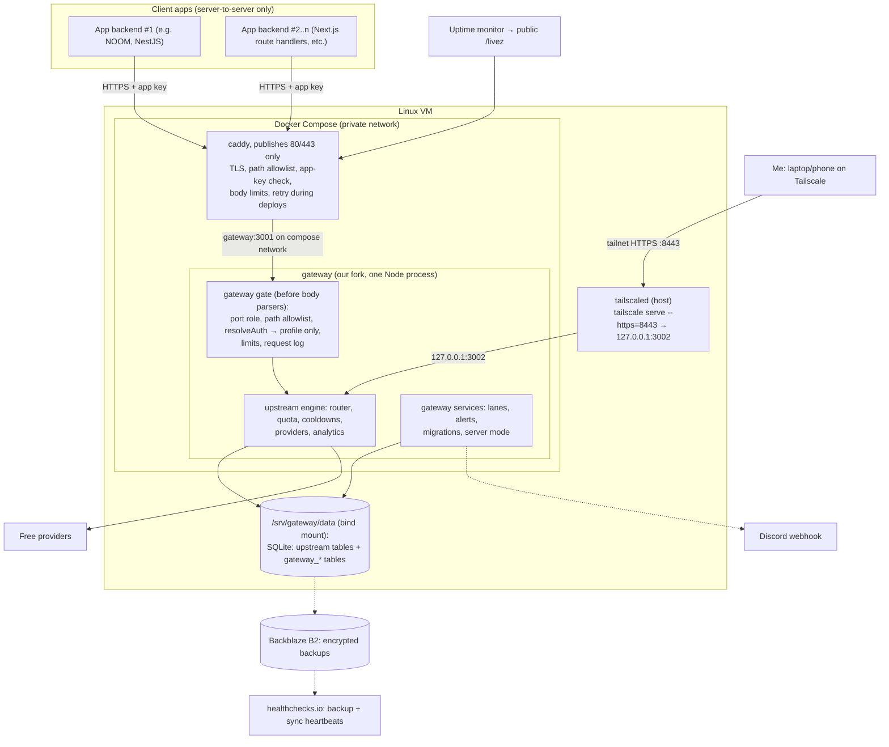

# AI Gateway — Implementation Plan (thin fork of freellmapi)

> **Status:** v3.1. M0 done (fork, baseline, analysis) — findings in [ANALYSIS.md](ANALYSIS.md). Next: M1.
> **Written:** 2026-11-22 · **Revised:** 2026-11-22 (v3)
> **Repo:** [`SmokeNova/ai-gateway`](https://github.com/SmokeNova/ai-gateway), a GitHub fork of [`tashfeenahmed/freellmapi`](https://github.com/tashfeenahmed/freellmapi) (MIT, TypeScript: Express 5 + SQLite + React/Vite dashboard). Based on upstream release **v0.16.38** (2026-11-21).
> **Background:** [research/AI_GATEWAY_RESEARCH_REPORT.md](research/AI_GATEWAY_RESEARCH_REPORT.md), [research/ARCHITECTURE_AND_PROVIDERS_DEEP_DIVE.md](research/ARCHITECTURE_AND_PROVIDERS_DEEP_DIVE.md). The earlier build-from-scratch plan is kept as [research/FROM_SCRATCH_PLAN.md](research/FROM_SCRATCH_PLAN.md) (deferred "Option C").

Facts marked **(verified)** were confirmed by reading upstream source. Facts marked **(Q#)** are open questions answered in M0 (§12, [ANALYSIS.md](ANALYSIS.md)).

### Revision log
| Version | Change |
|---|---|
| v1 | First fork plan |
| v2 | Review #1: Docker-correct networking; key check before body parsing; stateful features forced off; no edits to upstream's busiest files; fork-owned tables and migrations; pre-deploy snapshot; weekly sync PR; graceful shutdown; scope cut ~40% |
| v3 | Review #2 and repo setup:<br>• **CI/sync made fork-safe**: our workflows have their own names, upstream's are disabled, deploys trigger only on `gateway-v*` tags, the sync job uses a token that may push workflow changes, plus a heartbeat<br>• **Request log written at admission** (not on `finish`), so aborted and in-flight requests count against limits; per-minute limits read from the same table, so nothing lives only in memory<br>• **Rollback only on hard health failures**; the live chat call is a warning; DB restore only when the schema changed; strict forced-command for the deploy key<br>• Public `/livez` answered by the gate with `{status}` only<br>• `forkFeature()` wrapping dropped (the allowlist already covers it); dangerous admin routes blocked by path; port role deny-by-default; schedulers started once<br>• Timeout budget aligned; Caddy retries during deploys; backup dead-man's switch; `ALLOWED_HOSTS` lists both hostnames; Q15 added; `/v1/models` handler added to touchpoints<br>• **Nothing app-specific in the gateway**: NOOM is just the first client and adapts on its side; app-specific integration work moved out of this repo<br>• One naming scheme: everything ours is called `gateway` (folder, tables, env vars, workflows, tags) |
| v3.1 | M0 findings ([ANALYSIS.md](ANALYSIS.md) §2):<br>• Public lane IDs are **`lane:<name>`** (upstream reserves `auto:fast`/`auto:smart`); the gate rewrites them to upstream targets<br>• **Gemini adapter drops `input_audio`** → one small adapter patch (also offered upstream)<br>• STT has no chains → STT permitted by path, `model: "auto"`<br>• Lanes seeded by our own boot step with `auto_include_new_models=0`<br>• Gate strips behaviour-changing headers; `NODE_ENV=production`; exact path matching<br>• Tokens and stream errors read by a response tap instead of joining upstream tables<br>• Possibly **no edit to `app.ts`** (outer app wraps `createApp()`)<br>• Keep upstream's `ci.yml`; disable the other three workflows<br>• Data path, DB name, backup and health-check settings corrected |

---

## 1. What we are building and why

### 1.1 Goal
One self-hosted, always-on **AI gateway** that all my portfolio apps call **server-to-server** through one OpenAI-compatible `/v1` endpoint. It stacks **free-tier AI providers** (Groq, Gemini, OpenRouter `:free`, Mistral, Cloudflare Workers AI, Z.ai, OVH…) behind automatic failover, so an app keeps working when one free tier is rate-limited or down. **Target cost: $0/month.**

The gateway is **general-purpose**. It knows about *apps* (keys, limits, allowed lanes) and *lanes* (capabilities), never about any particular app's domain. The first client is NOOM (a Loom-style recorder); future Next.js/NestJS apps use the same API the same way.

### 1.2 Requirements
| # | Requirement | Priority |
|---|---|---|
| R1 | OpenAI-compatible chat (streaming + non-streaming, tools, `response_format` json_schema), vision, audio input, speech-to-text, embeddings | Must |
| R2 | Automatic failover across free providers, skipping providers that are out of quota or cooling down | Must (upstream does this) |
| R3 | Safe on a public server: only the inference API is internet-facing; the admin side is private | Must |
| R4 | A separate revocable key per app, with per-app limits and an allowlist of lanes | Must |
| R5 | Per-app usage logs and analytics | Must |
| R6 | Admin dashboard for provider keys, fallback chains and analytics | Must (upstream has one) |
| R7 | General capability **lanes** (fast, smart, audio input, STT, embeddings), never app-specific routes or payloads | Must |
| R8 | Reliable ops: health checks, alerts, offsite backups, reproducible deploys, rollback | Must |
| R9 | Stay mergeable with upstream (new providers, quota changes, quirk fixes) | Must |
| R10 | No surprise billing: no payment method on any provider account used | Must (operational rule) |

### 1.3 Non-goals
- No multi-tenant signups, reselling or sharing. Free-tier terms allow single-owner use only.
- No coding-agent features in the cloud instance. Claude Code, Codex etc. keep using a separate *local* freellmapi install.
- No app-specific endpoints, schemas or prompts in the gateway. If an app needs a special flow, it composes it from lanes on its own side.
- No rewrite. This is a **thin fork**: we turn things off rather than delete code, and avoid editing upstream's busiest files.

---

## 2. Decisions log

| Decision | Choice | Why | Rejected |
|---|---|---|---|
| Engine | **Fork freellmapi** | TypeScript (my stack); free-tier quota engine (RPM/RPD/TPM/TPD per provider/model/key with escalating cooldowns); 87+ providers; STT; dashboard; MIT; very active | **Bifrost** (Go; no free-tier awareness; cross-request cooldown is Enterprise-only). **LiteLLM** (~4 GB RAM + Postgres; 2026 supply-chain compromises). **New-API** (built for reselling; AGPL). **Cloudflare AI Gateway** (no per-app tokens) |
| Fork style | **Thin fork.** Our server code in `server/src/gateway/`; upstream files get only small, marked edits in a few low-churn places | `proxy.ts` saw ~35 commits in two months; edits there or in `router.ts`/`request-log.ts` would conflict on almost every merge | Editing routing/proxy code directly |
| Naming | Everything we add is called **`gateway`**: `server/src/gateway/`, `server/src/__tests__/gateway/`, `docs/gateway/`, tables `gateway_*`, env `GATEWAY_*`, workflows `gateway-*.yml`, release tags `gateway-v*`, code marker `// GATEWAY:` | One searchable prefix; never collides with upstream names (verified: upstream has no `gateway` folder, table or tag) | `fork/` (describes how, not what) |
| Hosting the repo | **GitHub fork** (public), `upstream` remote for merges | Standard for "my changes on top of a living project"; shows attribution; easy upstream PRs. No secrets in git, ever | A private copy (loses the fork link; no benefit since there are no secrets) |
| Why upstream says "local only" | A **trust-model and support-scope** problem, not bad code | Source shows real hardening (§4) | — |
| Network exposure | **The gateway container publishes nothing publicly.** Caddy (only thing on 80/443) reaches it over the compose network. The admin port is published on `127.0.0.1` only and reached via **`tailscale serve`** | In a container the app must listen on `0.0.0.0`; Docker-published ports **bypass `ufw`**; binding to the Tailscale IP fails if Tailscale starts late | Publishing admin on the Tailscale IP; relying on `ufw` for Docker ports |
| Request gate | Our middleware **mounted before body parsing**: port role, path allowlist, key via upstream's exported `resolveAuth()`, **only `kind === 'profile'`**, limits | Upstream parses bodies (25 MB on `/v1`) **before** auth (verified, `app.ts`). Profile-only stays deny-by-default if upstream adds key kinds | Editing `requireInferenceAuth` in `proxy.ts` |
| Our data | **Gateway-owned tables + our own migration runner** (`gateway_migrations`) | Upstream may later add similar columns; duplicates would break boot | Adding columns to upstream tables |
| Dashboard | **Upstream dashboard as is**. Per-app limits via a config file + small admin API; an Apps page later (M6) | Saves days; not needed to run | A separate Next.js dashboard |
| Upstream sync | **Weekly CI job** merges the latest upstream *release tag* and opens a PR with test results | ~40 releases/month is too many for manual merges | Ad-hoc merges |
| Hosting | One small Linux VM (Oracle Always Free → GCP `e2-micro` fallback), Docker Compose, Caddy, Tailscale | ~40 MB RAM idle, one process, SQLite | Render (shares free hours), serverless (upstream can't run there) |

---

## 3. What upstream already gives us (verified)

| Capability | Where (upstream) | Notes |
|---|---|---|
| Free-tier quota engine | `server/src/services/ratelimit.ts`, `services/provider-quota.ts` | RPM/RPD/TPM/TPD per provider/model/key; escalating cooldowns |
| Monthly caps on provider keys | `services/key-budget.ts` | On *provider* keys, not app keys |
| Request-aware routing | `services/router.ts` `routeRequest()` | Filters models that can't handle images, tools, structured output or the prompt length |
| Named fallback chains | `routes/profiles.ts`, `routes/fallback.ts` | `auto`, `auto:<name>`, routing strategy per chain |
| Per-app keys | `routes/client-profiles.ts` | `sk-cp-…`; name, hash, system prompt, enabled. **No limits** |
| `/v1` auth | `lib/system-prompt.ts` `resolveAuth()`; `routes/proxy.ts` `requireInferenceAuth()` | `resolveAuth()` is pure and exported; returns `unified` or `profile` |
| Admin auth | `routes/auth.ts`, `middleware/requireAuth.ts` | Email + password (scrypt), session token, re-auth throttling |
| Host allowlist | `middleware/allowed-hosts.ts` | Exact hostnames, off unless `ALLOWED_HOSTS` is set |
| First-run claim protection | `lib/setup-code.ts` | Non-local setup needs a code printed to the log |
| Forwarded headers | `lib/loopback.ts`, `TRUST_PROXY` | Right-most `X-Forwarded-For` hop |
| Per-IP rate limiting | `middleware/rateLimit.ts` | Mounted after body parsing |
| SSRF guard | `lib/url-guard.ts`, `FREEAPI_BLOCK_PRIVATE_PROVIDER_URLS` | Opt-in |
| Health | `routes/status.ts`: `/livez`, `/readyz`, `/api/ping` | `/livez` body includes `version`, `uptime_s`, `stored_keys_decryptable` (not for public) |
| Request analytics | `lib/request-log.ts`, `routes/analytics.ts`, `requests` table | `caller` = internal code path, not the app |
| Server log viewer | `lib/server-logs.ts`, `lib/log-redaction.ts` | Ring buffer + persisted warnings/errors, secrets redacted |
| Off-by-default features | response cache, context handoff, compression | We force them off anyway (§6.1) |
| Backups, retention, declarative config, Docker image | `lib/db-backup.ts` (encrypted, one overwritten object, auto-restore at boot if the DB is missing), `*_RETENTION_DAYS`, `services/declarative-config.ts`, `Dockerfile` (Node 24, drops to `node` user, amd64+arm64, data in `/app/server/data/freeapi.db`) | — |
| Upstream workflows | `.github/workflows/ci.yml`, `docker.yml`, `cli-release.yml`, `desktop-release.yml` | Disabled in our fork (§7) |

---

## 4. Why upstream is local-only, and what we do about each reason

| # | Reason | Our mitigation | Milestone |
|---|---|---|---|
| L1 | **Out of support scope** (`SECURITY.md` excludes public exposure) | We own server hardening; weekly sync of releases | M1, M2 |
| L2 | **The unified key can do everything** | Public port accepts **only per-app (`profile`) keys** | M1 |
| L3 | **Per-app keys have no limits** | Per-app RPM/RPD/concurrency, optional tokens/day, lane allowlist | M3 |
| L4 | **Local requests are trusted** (desktop session, setup without the code) | Server mode removes local trust (blocked paths; edits only if M0 says a path block isn't enough) | M1 |
| L5 | **Admin shares the public port** | Admin port never routed publicly; gate decides role by arrival port, deny-by-default | M1, M2 |
| L6 | **Extra entry points** (Ollama emulation, `/mcp`, `/v1beta`, `/v1/t/{token}`, `/v1/messages`, `/v1/responses`) | Not on the public allowlist; Caddy allowlist as a second layer | M1, M2 |
| L7 | **Unsafe-by-default switches** | Server mode refuses to start unless set safely | M1 |
| L8 | **Self-update / Watchtower** (`/api/update` runs commands; Watchtower needs the Docker socket) | `/api/update*` blocked on every port; Watchtower never used | M1, M2 |
| L9 | **Fast release cadence** | Weekly sync PR + full test suite | M2 |
| L10 | **Bodies parsed before auth** | Gate before the parsers; Caddy rejects keyless requests; per-endpoint body limits | M1, M2 |
| L11 | **Features that keep state across requests** (context handoff, reasoning memory, response cache, conversations…). All end users of an app share one key | Server mode forces them off; a test proves two requests with the same first message don't affect each other | M1 |

---

## 5. Target architecture



**Ports and exposure:**
- In the container the app listens on `0.0.0.0:3001` (public role) and `0.0.0.0:3002` (admin role). The gate decides the role from `req.socket.localPort`: **admin only if it equals `GATEWAY_ADMIN_PORT`; every other port gets public rules** (deny-by-default).
- `docker-compose.yml`: `gateway` publishes **only** `127.0.0.1:3002:3002`; port 3001 is not published. `caddy` publishes `80` and `443`. Nothing else.
- Admin access: `tailscale serve --bg --https=8443 http://127.0.0.1:3002` (tailnet-only HTTPS, survives reboots, independent of container start order).
- **Cloud firewall** (Oracle VCN security list / GCP firewall rule): ingress 80 and 443 only. `ufw` additionally blocks public SSH and any host service, but it does **not** govern Docker-published ports, so exposure is controlled by what compose publishes.
- **IPv4 only:** no AAAA record. If the VM has a public IPv6 address, the exposure checks also run against it.
- **Exposure checks (every deploy, from outside the tailnet):** ports 3001, 3002, 8443 and 22 on the public IP refuse connections; `https://gw.<domain>/api/ping`, `/mcp`, `/v1beta/x`, `/` return 404; `/v1/models` without a key returns 401 (JSON).

---

## 6. Detailed design

All our server code lives in `server/src/gateway/`; tests in `server/src/__tests__/gateway/`. Every upstream file we touch gets a `// GATEWAY:` comment and an entry in [UPSTREAM_TOUCHPOINTS.md](UPSTREAM_TOUCHPOINTS.md).

**Planned upstream touchpoints (the whole list):**
- `server/src/index.ts`: build an outer Express app that runs the gate, then mounts upstream's `createApp()`; second listener on the admin port (`app.listen` with no ready callback, so schedulers start once) pushed into the graceful-shutdown list; gateway bootstrap (migrations, lane seeding, startup checks, alerts poller).
- `server/src/app.ts`: **only if** the outer-app approach fails in M1 (the gate parses JSON itself after the key check, and upstream's parsers skip an already-parsed body — ANALYSIS F13).
- `server/src/providers/google.ts`: map `input_audio` parts to Gemini `inlineData` (ANALYSIS F2). Offered upstream as a PR; dropped from the fork once merged.
- No `auth.ts` edit: M0 showed local trust is removed by blocking paths and running behind Caddy (ANALYSIS §4).
- `/v1/models` filtering needs **no** upstream edit: the gate serves it on the public port (M3).

### 6.1 Server mode (`GATEWAY_SERVER_MODE=1`)

**Gate** — first middleware in `app.ts`, before helmet, CORS and body parsing.

*Every port:* block by path, 404: `/api/update*`, `/api/premium*`, `/api/auth/desktop-session`, `/v1/t/*` (injects the unified key), `/mcp`, `/v1beta`, Ollama emulation paths ([ANALYSIS.md](ANALYSIS.md) §4).

*Admin port:* everything else passes through to upstream (its own admin auth applies).

*Public port (anything not the admin port):*
1. **Path allowlist** (method + path), everything else 404:
   - `POST /v1/chat/completions`
   - `POST /v1/audio/transcriptions`
   - `POST /v1/embeddings`
   - `GET /v1/models` (served by the gate, filtered per key)
   - `GET /livez` (served by the gate: `{"status":"ok"}` only, no version or uptime)

   Matching is exact (method + lowercase path, no trailing slash), because Express itself is case-insensitive and ignores trailing slashes. `HEAD`, `/V1/...`, `/v1/models/`, `/v1/v1/...` are all 404.
2. **Body size from `Content-Length`**: over the endpoint's limit → 413. Chunked bodies are bounded by Caddy.
3. **Key check without a body:** upstream's exported `extractApiToken()` (`Authorization` Bearer, then `x-api-key`, then `x-goog-api-key`), then `resolveAuth(token)`; allow only `kind === 'profile'`, else 401.
3b. **Strip behaviour-changing request headers:** `X-FreeLLM-Cache`, `Idempotency-Key`, `x-session-id`, `anthropic-version`, and any client `X-Request-ID` (the gate sets its own = the request-log ID). Internal routing headers are removed from public responses.
4. **Endpoint check:** the key's lanes imply endpoints, so a key with no STT lane gets 403 `endpoint_not_allowed` on `/v1/audio/transcriptions`.
5. **Limits** (all read from `gateway_request_log`, §6.2): concurrency, per-minute, per-day, tokens/day → 429 with `Retry-After`.
6. **Admit:** insert the request-log row, then continue to upstream.

**Post-parse rules (JSON endpoints only).** After the key check the gate parses JSON itself (same limits); upstream's parsers then skip the already-parsed body.
- **Lane rule:** `body.model` must be a `lane:<name>` on the key's list, else 403 `lane_not_allowed`. Raw upstream model IDs, `auto`, `auto:*` and `fusion` are never accepted publicly (upstream has no per-key model allowlist, so this rule is the only control).
- **Rewrite:** the lane ID is replaced by its upstream target (§6.3) before upstream sees the body.
- **Modality rule:** if the request contains image or `input_audio` parts, the lane must declare that input modality (§6.3). Else 422 `no_capable_model`.
- **Multipart STT:** enforced by path (step 4). The gate doesn't parse multipart. Apps send `model: "auto"`; upstream only lets that field select STT rows (ANALYSIS Q13).

**Body limits** (same values in Caddy and the gate): 25 MB for STT, 8 MB for chat (base64 images/audio), 1 MB for embeddings.

**Forced off in server mode:** response cache, context handoff, compression, reasoning memory, fusion, update checks, and anything else M0 finds that keeps state across requests (Q12) or phones home (Q15).

**Startup checks** (refuse to start if any fail):
- `ENCRYPTION_KEY` set and not the placeholder
- `ALLOWED_HOSTS` set and containing both the public hostname and the `*.ts.net` admin hostname (exact names; upstream has no wildcards)
- `TRUST_PROXY=1` (one proxy hop; not `true`, which would trust spoofed `X-Forwarded-For`)
- `FREEAPI_BLOCK_PRIVATE_PROVIDER_URLS=true` (also blocks server-side image fetches to private, loopback and Tailscale addresses)
- `NODE_ENV=production` (otherwise 5xx messages are returned raw)
- `FREEAPI_DESKTOP` unset
- `GATEWAY_ADMIN_PORT` ≠ `PORT`
- forced-off features really are off

**Upstream settings we set:** `PROXY_RATE_LIMIT_RPM=600` (per-app limits are the real control; app egress IPs on Render/Vercel are shared), `FALLBACK_TIME_BUDGET_MS=55000` (§6.4), `HEALTH_CHECK_INTERVAL_MS=900000` (fewer key probes), `FREELLMAPI_UPDATE_CHECK=off`, `FREEAPI_DB_BACKUP_INTERVAL_MS=21600000`.

**Password reset:** the one-time code goes to the server log, readable only by me (SSH/Tailscale).

### 6.2 Apps: limits and request log (gateway tables only)

An **app** = one upstream client profile (`sk-cp-…` key, created in upstream's dashboard) + a gateway policy.

- **`gateway_app_policies`**: `profile_id` (PK → `client_profiles.id`), `max_concurrent`, `max_rpm`, `max_rpd`, `max_tpd` (all nullable = unlimited), `lanes_json`, `updated_at`.
- **`gateway_request_log`**: one row per **client request** (not per upstream attempt):
  `id`, `profile_id`, `lane`, `endpoint`, `admitted_at_ms`, `finished_at_ms`, `status_code`, `outcome` (`ok` | `client_error` | `upstream_error` | `stream_error` | `client_abort` | `interrupted`), `error_code`, `latency_ms`, `prompt_tokens`, `completion_tokens`. Index `(profile_id, admitted_at_ms)`. The row `id` is also sent upstream as `X-Request-ID`, so it appears as `execution_id` in upstream's chat responses and logs.
  - **Inserted at admission** (gate step 6), so in-flight requests already count.
  - **Response tap:** the gate wraps `res.write`/`res.end` to pick up the final `usage` object (present on every chat response, streams included) and any SSE `stream_error` frame, without buffering the stream. No join on upstream tables (upstream's `requests` has one row per *attempt* and stores no request ID).
  - **Completed on `res.on('close')`**: if `res.writableFinished`, outcome from the status and the tap; otherwise `client_abort`.
  - On boot, rows with no `finished_at_ms` are marked `interrupted` (crash or kill).
  - Requests the gate rejects for a *known* app (403/422/429) are logged with `outcome = client_error` and **don't** count towards limits. 401s have no app and aren't logged here.
- **Limit checks** are SQL counts on admitted rows: concurrency = unfinished rows; per-minute = last 60 s; per-day = since 00:00 UTC; tokens/day = sum of the tapped token columns. `max_tpd` is **soft** (a request in flight may overshoot). STT and embeddings responses carry no chat-style usage, so they count requests only. Nothing is kept only in memory, so restarts and deploys don't reset anything.
- **Managing policies:**
  - `gateway.config.json` (`GATEWAY_CONFIG_PATH`) maps profile **name** → policy, plus lane definitions (§6.3); applied idempotently at boot.
  - Admin API on the admin port, behind upstream's `requireAuth`: `GET/PUT /api/gateway/apps/:profileId/policy`.
- **Per-app analytics:** `GET /api/gateway/analytics/apps?range=24h|7d|30d` → requests, outcomes, p50/p95 latency, tokens per app.
- **Retention:** prune after 90 days (matches upstream analytics).

### 6.3 Lanes (general capabilities)

Principle: **a lane expresses intent; upstream works out capabilities from the request** (images, tools, structured output, prompt length).

Apps use **public lane IDs** (`lane:<name>`). The gate maps each to an **upstream target**; apps never see upstream names, so upstream's reserved aliases (`auto:fast`, `auto:smart`, …) can't collide. Lanes are defined in `gateway.config.json`:

```json
{
  "lanes": {
    "lane:fast":  { "endpoint": "chat", "input": ["text", "image"], "chain": "gw-fast" },
    "lane:smart": { "endpoint": "chat", "input": ["text", "image"], "chain": "gw-smart" },
    "lane:audio": { "endpoint": "chat", "input": ["text", "audio"], "chain": "gw-audio" },
    "lane:stt":   { "endpoint": "transcriptions" },
    "lane:embed-bge-m3": { "endpoint": "embeddings", "family": "<upstream family name>" }
  },
  "apps": {
    "example-app": { "lanes": ["lane:audio", "lane:stt", "lane:smart"], "max_rpm": 30, "max_rpd": 1000, "max_concurrent": 4 }
  }
}
```

| Lane | Endpoint | Upstream target | Contents |
|---|---|---|---|
| `lane:fast` | chat | profile `gw-fast` → `model: "auto:gw-fast"` | Groq first; low latency |
| `lane:smart` | chat | profile `gw-smart` | Gemini and larger models first |
| `lane:audio` | chat with `input_audio` | profile `gw-audio` | Only models whose adapter forwards audio (Gemini via the patched adapter) |
| `lane:stt` | `/v1/audio/transcriptions` | `model: "auto"` (all enabled STT rows, by priority) | Ops enables/disables STT rows; upstream has no STT chains |
| `lane:embed-<family>` | `/v1/embeddings` | the family name | One model family only (upstream enforces this) |

- **Seeding:** upstream's declarative config has no profiles section, so a gateway boot step upserts the `gw-*` profiles (upstream `profiles`/`profile_models` tables, through upstream's own functions where possible) with **`auto_include_new_models=0`**, so catalog sync can't add unwanted models. Model lists stay editable in the dashboard.
- Apps never name providers; they name lanes. Which models sit behind a lane is an ops decision, changeable without touching any app.
- **Named chains are strict** (ANALYSIS Q8): when a lane's models are exhausted the request fails; it never spills into other models. So the audio lane needs no router patch, only the Gemini adapter fix. A gateway test fails if any model in `gw-audio` is served by an adapter that drops audio.
- **Never silently strip content:** if no model can take an image or audio request, the client gets 422 `no_capable_model`, never a text-only answer.
- **STT timestamps:** Groq returns `segments` for `verbose_json`; Voxtral returns text only. Apps that need timestamps treat a missing `segments` as a failure (or ops leaves Voxtral disabled for STT).
- Deferred lanes: `lane:code`, `lane:reasoning`, `lane:vision`.

### 6.4 Timeouts, errors, streaming, retries

**Error contract** (in [INTEGRATION.md](INTEGRATION.md), M4):

| Status | Code | Meaning | Client should |
|---|---|---|---|
| 401 | `invalid_api_key` | Missing or wrong key | Fix config |
| 403 | `lane_not_allowed` / `endpoint_not_allowed` | Key not allowed this lane/endpoint | Fix config |
| 413 | `body_too_large` | Over the endpoint's limit | Shrink input |
| 422 | `no_capable_model` | No model in the lane can handle the input | Try another lane or input form |
| 429 | `app_rate_limited` / `app_daily_limit` / `app_concurrency_limit` | This app hit its own policy (`Retry-After`) | Back off |
| 502/503 | — | Gateway restarting (deploy) | Retry with backoff |
| upstream's | (Q11) | Every provider in the lane is exhausted | Fall back to another lane or fail |

- **Time budget (chat):** upstream's `FALLBACK_TIME_BUDGET_MS` stops starting new attempts after the budget (from the 3rd attempt on). We set **55 s**; a single slow attempt can still run up to its provider timeout. Rule for clients: a chat deadline of **≥ 60 s** gets the gateway's full failover; shorter is fine if the app prefers to cut off and try another lane itself. On client disconnect, chat stops the in-flight call and the fallback loop (ANALYSIS Q14).
- **STT and embeddings have no budget and ignore disconnects:** fixed per-attempt timeouts (STT 60 s, embeddings 30 s) across every enabled provider. Keep few STT rows enabled; clients set their own deadline. Candidate upstream PR.
- **Streaming through Caddy:** `flush_interval -1`, read/write timeouts ≥ 120 s. Leave `STREAM_KEEPALIVE_MS` off (default): once a keep-alive is sent, upstream can no longer fail over invisibly.
- **Deploy restarts:** Caddy `lb_try_duration 30s` / `lb_try_interval 250ms`, so new requests wait for the new container instead of getting a 502. In-flight requests drain on the old container (§6.7). Clients still retry 502/503 with backoff.
- **Auth header:** one documented form, `Authorization: Bearer sk-cp-…`. Caddy checks the same header(s) the gate accepts and returns a JSON 401.

**Composing flows on the client side (general pattern, not gateway code):** an app that needs, say, "audio in → structured JSON out" tries `lane:audio` with `json_schema`; on failure it falls back to `lane:stt` (`verbose_json`) followed by `lane:smart` with `json_schema`. Each step has its own deadline; the sum stays inside the app's own overall timeout. [INTEGRATION.md](INTEGRATION.md) documents this pattern generically; each app implements it in its own repo.

### 6.5 Logging, health and alerts
| Layer | What |
|---|---|
| Request analytics | Upstream `requests` + `gateway_request_log` (per app) |
| Server logs | Upstream ring buffer + persisted warnings/errors (redacted), viewed over Tailscale |
| Container logs | `json-file` rotation (`max-size: 10m`, `max-file: 5`) |
| Health | Compose healthcheck hits the **admin** port's `/livez` inside the container (full upstream body). Public monitor hits `https://gw.<domain>/livez` (gate's `{status}` only) |
| Alerts | `gateway/alerts.ts` polls SQLite every 5 min, posts to Discord at most once an hour per kind: (1) provider key unhealthy/invalid; (2) newest local backup older than 12 h; (3) **lane exhausted**: >20% of a lane's requests in the last 15 min ended `upstream_error`; (4) `/readyz` 503 |
| Heartbeats | healthchecks.io: pinged after each successful B2 upload and by the weekly sync job; alerts by email if missed |
| Privacy | Prompt/response bodies not stored (upstream default). Audio never logged |

### 6.6 Backups, migrations, deploy and rollback
- **Data on a bind mount:** `/srv/gateway/data` → `/app/server/data` (DB file `freeapi.db`). Upstream's entrypoint chowns it and drops to the `node` user on every start. Host tools (`sqlite3`, restore script) work without entering the container.
- **Backups:** upstream's encrypted backup (`FREEAPI_DB_BACKUP_PATH=/app/server/data/backups/freeapi.db.enc`, AES-256-GCM, every 6 h, its own `FREEAPI_DB_BACKUP_KEY`) is **one overwritten file** → host cron `rclone copy` to a B2 bucket with **versioning on** and a lifecycle rule keeping old versions 30 days → on success, ping healthchecks.io. Upstream restores this file automatically at boot when the DB is missing.
- **`ENCRYPTION_KEY`** lives in my password manager. Losing it loses every stored key.
- **Migrations:** upstream's run as usual; ours live in `server/src/gateway/migrations/`, run by our runner after upstream's, tracked in `gateway_migrations`. Gateway tables only, never `ALTER` on upstream tables.
- **Deploy** (`deploy.sh <tag>` on the VM):
  1. Record the current image tag and both schema versions (upstream's migration table + `gateway_migrations`).
  2. Snapshot: `sqlite3 data/freeapi.db ".backup snapshots/pre-<tag>.db"` (keep last 5).
  3. Pull the new image, `docker compose up -d`.
  4. **Hard checks** (decide rollback): `/livez` healthy within 90 s; exposure checks (§5); keyless `/v1/models` → 401.
  5. **Soft check** (warning only, Discord): one tiny chat call with a canary app key. A provider outage must not roll back a healthy deploy.
  6. If a hard check fails → rollback.
- **Rollback** (`deploy.sh rollback <tag>`): previous image tag; restore the snapshot **only if either schema version changed** (otherwise keep live data). Restore = `compose stop gateway` → remove `freeapi.db-wal`/`-shm` → copy snapshot → `compose up -d` (the entrypoint fixes ownership).
- **Restore drill** in M2: delete the DB, put the B2 backup file in place, start → upstream restores it at boot; confirm keys decrypt and apps work.

### 6.7 Graceful shutdown
- Compose: `init: true`, `stop_grace_period: 60s`.
- On SIGTERM (upstream's `lib/graceful-shutdown.ts`, with our second server added to its list): stop accepting on both listeners, let in-flight requests and streams finish (≤ 50 s), complete their request-log rows, close SQLite. No in-memory counters to flush.

---

## 7. Repo, workflows and upstream sync

### 7.1 Layout
```
ai-gateway/                     (GitHub fork of freellmapi)
├── .github/
│   ├── README.md               ← our README (GitHub shows it instead of upstream's root README; no merge conflicts)
│   └── workflows/
│       ├── ci.yml                       upstream's test matrix, kept enabled (no secrets)
│       ├── docker.yml, cli-release.yml, desktop-release.yml   upstream's, disabled in our repo
│       ├── gateway-ci.yml               gitleaks (tests already run in ci.yml)
│       ├── gateway-deploy.yml           on tag gateway-v*
│       └── gateway-upstream-sync.yml    weekly + manual
├── deploy/                     docker-compose.yml, Caddyfile, bootstrap.sh, deploy.sh, gateway.config.example.json
├── docs/
│   ├── en/, zh-cn/, …          upstream docs (untouched)
│   └── gateway/                our docs: PLAN, ANALYSIS, UPSTREAM_TOUCHPOINTS, INTEGRATION, RUNBOOK, research/
├── server/src/
│   ├── gateway/                all our server code
│   └── __tests__/gateway/      our tests
└── (everything else upstream, untouched)
```

### 7.2 Remotes, branches, tags
- `origin` = `SmokeNova/ai-gateway`, `upstream` = `tashfeenahmed/freellmapi`. `gh repo set-default` points at our repo, so PRs never accidentally target upstream.
- `main` = an upstream **release tag** + our commits. We merge release tags only, never upstream `main`.
- Our releases are tagged `gateway-vX.Y.Z`. **Upstream tags (`v0.16.x`) are never pushed to `origin`** (`remote.origin.tagOpt --no-tags`, `push.followTags false`), and our deploy workflow only matches `gateway-v*`.

### 7.3 Workflows
- **Actions is off by default in a fork.** When enabled (M2), immediately `gh workflow disable` upstream's `docker.yml` (would push `ghcr.io/<us>/freellmapi`), `cli-release.yml` (npm publish) and `desktop-release.yml` (fires on any `v*` tag). They're disabled, not deleted, so upstream edits to them never cause merge conflicts. Upstream's `ci.yml` stays on: it runs the full suite on Node 20/22/24 with no secrets. Any new upstream workflow in a sync PR is listed for a decision.
- **Sync token:** the default `GITHUB_TOKEN` cannot push commits that change `.github/workflows/`, and upstream changes its workflows often. The sync job uses a **fine-grained PAT** scoped to this repo only (Contents, Pull requests, Workflows: read/write), stored as secret `GATEWAY_SYNC_TOKEN`.
- **`gateway-upstream-sync.yml`** (weekly, Monday; also manual):
  1. Fetch upstream tags; if the newest release tag is already merged, ping the heartbeat and stop.
  2. Create `upstream-sync/<tag>` from `main` and merge the tag.
  3. **Clean merge:** push, run lint/build/full tests including the gateway security tests, open a PR with the release-notes link and the test summary.
  4. **Conflicts:** abort the merge, push a branch `upstream-sync/<tag>-conflict` pointing at the bare upstream tag, and open a **draft PR** listing the conflicting files, to be resolved locally.
  5. List any new upstream workflow files in the PR (to disable) and any new public routes (the route-inventory test fails until decided).
  6. Ping the healthchecks.io heartbeat.
- **Scheduled workflows are disabled by GitHub after 60 days without repo activity.** Merging sync PRs counts as activity; the heartbeat catches it if the job stops.
- **GHCR image** is public (no secrets inside), so the VM pulls without a token.
- **Upstream PRs:** offer upstream-friendly pieces (per-key limits, a server-mode switch) back to freellmapi from a clean branch. Each one accepted is less fork to maintain.
- Keep the MIT `LICENSE` and attribution ("Fork of freellmapi by Tashfeen Ahmed"). Package names stay as they are.

---

## 8. Milestones

### M0: Fork, baseline and analysis ✅
- ✅ GitHub fork `SmokeNova/ai-gateway`; local clone with `origin`/`upstream`; `main` at `v0.16.38`; docs moved to `docs/gateway/`.
- ✅ Baseline: `npm ci`, `npm run build`, `npm run lint`, `npm test`, recorded in [ANALYSIS.md](ANALYSIS.md) §1.
- ✅ [ANALYSIS.md](ANALYSIS.md): route inventory, boot/scheduler inventory, answers to Q1–Q15 (Q7 deferred to M2), and the plan changes they forced (v3.1).
- Running locally with Docker Compose needs Docker Desktop (not installed); otherwise the first compose run happens on the VM in M2.

### M1: Server mode and gate (3–4 days)
- `gateway/server-mode.ts` (startup checks, forced-off features), the gate (exact path matching, header stripping, JSON parse after the key check), path blocks, the outer app + second listener in `index.ts`, empty migration runner, graceful shutdown. First task: confirm the outer-app approach works without editing `app.ts` (ANALYSIS F13).
- `deploy/docker-compose.yml` and `deploy/Caddyfile` with the §5 network setup (run locally if Docker Desktop is installed).
- **Tests** (Vitest + supertest, in `server/src/__tests__/gateway/`):
  - route inventory: the public port 404s every non-allowlisted path, and the test **fails if a new upstream route appears without a decision**
  - only profile keys on the public port; no body read before the key check (an anonymous 20 MB POST gets 401 without being read)
  - port role is deny-by-default; blocked paths are blocked on both ports
  - public `/livez` returns only `{status}`
  - `HEAD`, upper-case and trailing-slash variants of allowed paths 404 on the public port
  - behaviour-changing headers (`X-FreeLLM-Cache`, `Idempotency-Key`, `x-session-id`) have no effect through the public port
  - an image URL pointing at `127.0.0.1:3002` is refused (SSRF)
  - startup checks fail on unsafe settings; setup without the code is rejected
  - two requests with the same first message don't affect each other
- **Done when:** all upstream tests and the new security tests pass.

### M2: Deploy and ops baseline (2–3 days)
- **VM** via `deploy/bootstrap.sh` (cloud-init compatible): Ubuntu 24.04; `deploy` user; SSH keys only, over Tailscale only; cloud firewall 80/443; `ufw`; 2 GB swap; `unattended-upgrades`; Docker, Tailscale, `sqlite3`, `rclone`; `/srv/gateway/{data,snapshots}`; `tailscale serve`.
- **Secrets:** `/srv/gateway/.env` and `gateway.config.json` on the VM only, mode 0600. CI never sees `ENCRYPTION_KEY` or provider keys.
- **Tailscale ACL:** my devices (`autogroup:member`) → `tag:gateway:8443,22`; `tag:ci` → `tag:gateway:22` only.
- **`gateway-ci.yml`**: gitleaks (upstream's `ci.yml` already runs lint, build and the full suite, including our tests).
- **`gateway-deploy.yml`** (tag `gateway-v*`): build the image for the VM's architecture only (native arm64 runner for Oracle A1, amd64 for GCP) → GHCR → join the tailnet as `tag:ci` → SSH as `deploy`. The key's `authorized_keys` entry is `command="/srv/gateway/bin/deploy-cmd",restrict`; `deploy-cmd` accepts only `SSH_ORIGINAL_COMMAND` matching `^(deploy|rollback) gateway-v[0-9]+\.[0-9]+\.[0-9]+$`. (The `deploy` user is in the `docker` group, which is effectively root; that's accepted because the key is usable only over the tailnet and only for this command.)
- Disable upstream workflows; `gateway-upstream-sync.yml`; B2 backups + heartbeat + restore drill; uptime monitor on public `/livez`.
- **Done when:** HTTPS works; admin reachable only over the tailnet (checked from a phone off Tailscale); restore drill passed; a deliberately broken deploy rolled back automatically; a provider-outage canary failure did **not** roll back.

### M3: Apps — limits and request log (2 days)
- Gateway tables and migrations; limit checks in the gate; admission insert + `close` completion; boot-time `interrupted` sweep; response tap for tokens and stream errors; config loader; admin policy API; per-app analytics; gate-served filtered `/v1/models`.
- **Tests:** 403 for disallowed lane/endpoint; 429 per limit with correct `Retry-After`; aborted and in-flight requests count; a burst can't exceed `max_rpd`/`max_concurrent`; counts survive restarts; one row per request even with fallbacks; rejected requests don't count.

### M4: Lanes and integration guide (2–3 days)
- Lane seeding boot step (`gw-*` profiles, `auto_include_new_models=0`), lane rewrite (chat → profile, embeddings → family, STT → `auto`), modality rule, 422 behaviour, the `google.ts` `input_audio` patch (+ upstream PR).
- **Tests:** vision, audio, tools and json_schema filtering; a lane's fallback never leaves its capability set.
- [INTEGRATION.md](INTEGRATION.md): auth, lanes, error contract, retry/deadline rules, the generic "compose lanes" pattern (§6.4), OpenAI SDK and Vercel AI SDK snippets, "keys on the server only".
- **App migrations happen in each app's repo**, against INTEGRATION.md. For NOOM that's a new provider behind its existing transcription port; NOOM's request shape may change to fit the gateway's general API, never the other way round.

### M5: Alerts and runbooks (1 day)
- `gateway/alerts.ts` (§6.5), retention, [RUNBOOK.md](RUNBOOK.md): add an app, rotate an app key, rotate a provider key, restore, roll back, apply an urgent upstream security fix.

### M6 (optional, later): Dashboard Apps page (2–3 days)
- Apps page (policy, lanes, per-app charts) and an App filter on Analytics, under `client/src/gateway/`, against the gateway admin API.

### Ongoing: upstream sync
- Review the weekly PR (~30 min when clean). Security fixes merged as soon as seen.

**Effort:** M1–M5 ≈ **10–13 focused days**. M6 adds 2–3 days.

---

## 9. Testing strategy
- **Upstream suite stays green** (~450 server test files): our regression net for every merge.
- **Gateway security tests are required** in CI and the sync PR: route inventory, key before body, profile keys only, port role, blocked paths, public `/livez`, startup checks, no cross-request state, no secrets in logs/errors.
- **Exposure checks** from outside on every deploy (§5).
- **Nightly live smoke** (GitHub Action, canary app key): one tiny chat, one STT, one embeddings call through production; Discord on failure. Catches free tiers changing.

---

## 10. Security, privacy and guardrails
1. **Only the §6.1 allowlist is public**, enforced in the gate *and* Caddy, checked from outside on every deploy.
2. **Admin never touches the internet:** `tailscale serve` or an SSH tunnel only.
3. **Apps get only per-app `sk-cp-…` keys,** kept on app *servers* only, never in `NEXT_PUBLIC_*` or browser code.
4. **No payment method on any provider account.** Gemini key in its own Google Cloud project with billing never enabled; OpenRouter chains use `:free` IDs only.
5. **Never log secrets, prompts or audio.**
6. **No Watchtower, no self-update.** Deploys go through CI/CD only.
7. **`ENCRYPTION_KEY` backed up offline.**
8. **Free-tier terms and privacy (decision for me):**
   - Single owner, own portfolio apps only, one account per provider, no reselling.
   - Gemini's free ("Unpaid") tier must not serve users in the EEA, Switzerland or the UK, and Google may use free-tier prompts/responses (including human review). Other free tiers have similar data terms.
   - **Before an app sends end-user content through the gateway:** either keep such providers out of the lanes that app uses, or accept the risk for a portfolio demo *and* add a privacy notice in that app saying content is processed by third-party AI providers. This is a per-lane model choice, not gateway code.

---

## 11. Providers and hosting notes
Groq (chat + Whisper), Google AI Studio (separate project, no billing; §10.8), OpenRouter `:free`, Mistral (Experiment tier, 1 req/s), Cloudflare Workers AI (upstream caps neurons at 9,000/day), Z.ai, OVH (no key; bottom of chains). Embeddings: Gemini or Cloudflare `bge-m3`, families kept separate. My **local** coding freellmapi uses different providers/projects so quotas aren't shared.

- **Oracle Always Free** may reclaim idle VMs (<20% CPU at p95 over 7 days). Upgrading the account to Pay-As-You-Go exempts it but attaches a card (conflicts with R10's spirit, though Always Free resources stay free); default is to keep the bootstrap script fast instead.
- **GCP `e2-micro`** includes only ~1 GB/month free egress; audio uploads count. Billing alert on.

---

## 12. Open questions (all answered or deferred in M0 → [ANALYSIS.md](ANALYSIS.md) §3)
| # | Question | Why it matters |
|---|---|---|
| Q1 | Does `/v1/audio/transcriptions` return `segments` with `verbose_json` via Groq and Mistral? | STT lane usefulness for timestamped transcripts |
| Q2 | Does `/v1/chat/completions` forward `input_audio` to Gemini, and which formats (ogg/opus, webm, wav, mp3)? Is there an audio capability flag? | Whether the audio lane works as is |
| Q3 | Do profile keys authenticate on STT and embeddings as well as chat? | Gate assumptions |
| Q4 | Exact token extraction in `requireInferenceAuth` (headers, precedence) | Gate must copy it |
| Q5 | `FREEAPI_DB_BACKUP_URL` contract | Whether rclone can go |
| Q6 | Catalog snapshot vs paid live feed: freshness, and how updates are verified | Model/quota freshness |
| Q7 | Oracle A1 capacity and idle-reclaim in practice | Hosting choice (resolved in M2) |
| Q8 | Does a failing named chain spill into the global fallback? | Audio lane without a router patch |
| Q9 | Is an `execution_id` exposed per request (stream/non-stream/STT/embeddings) and stored in `requests`? | Token join without editing `request-log.ts` |
| Q10 | ~~What does `/livez` expose?~~ **Answered:** version, uptime, key decryptability → gate serves its own public `/livez` | — |
| Q11 | Status/code when every provider in a lane is exhausted; how stream errors after a 200 are surfaced/recorded | Error contract, `stream_error` outcome, lane-exhausted alert |
| Q12 | Every feature with cross-request state: names, defaults, scope | Completing L11 |
| Q13 | Can the STT `model` field reach other models/providers? | STT lane enforcement |
| Q14 | Does a client disconnect abort upstream calls and the fallback loop? | Client-owned deadlines |
| Q15 | Background jobs at boot: which call providers with stored keys (quota/egress), which phone home; can a catalog update redirect a provider's base URL (key exfiltration)? | Free quota, egress, security |

---

## 13. Risks
| Risk | Impact | Mitigation |
|---|---|---|
| Upstream refactors `app.ts`/`index.ts` | Merge conflicts | Tiny, listed touchpoints; weekly PR surfaces them early |
| Upstream adds a public route | Blocked (safe), maybe a missing feature | Gate denies by default; route-inventory test fails until decided |
| Upstream adds cross-request state | Data mixing between end users | Release-note review in the sync PR; cross-request test in CI |
| Upstream adds a workflow | Runs in our repo | Sync job lists new workflows; disable before merging |
| Upstream adds per-key limits | Two systems | Our tables don't collide; switch to theirs |
| Free tiers change | Lanes degrade | Nightly smoke, lane-exhausted alert, catalog updates |
| VM reclaimed/lost | Downtime | Bootstrap script, B2 backups, restore drill |
| Bad deploy/migration | Outage, data risk | Snapshot, hard-check rollback, schema-aware restore |
| Upstream goes quiet | No new providers | MIT; the fork keeps working |

---

## 14. Deferred
Public status page · JSON logs · `lane:code`/`lane:reasoning`/`lane:vision` · key expiry/notes · Dashboard Apps page (M6) · multi-arch images · recorded contract fixtures · TTS and image generation
