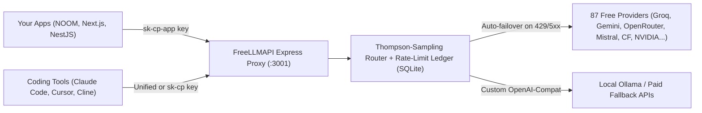
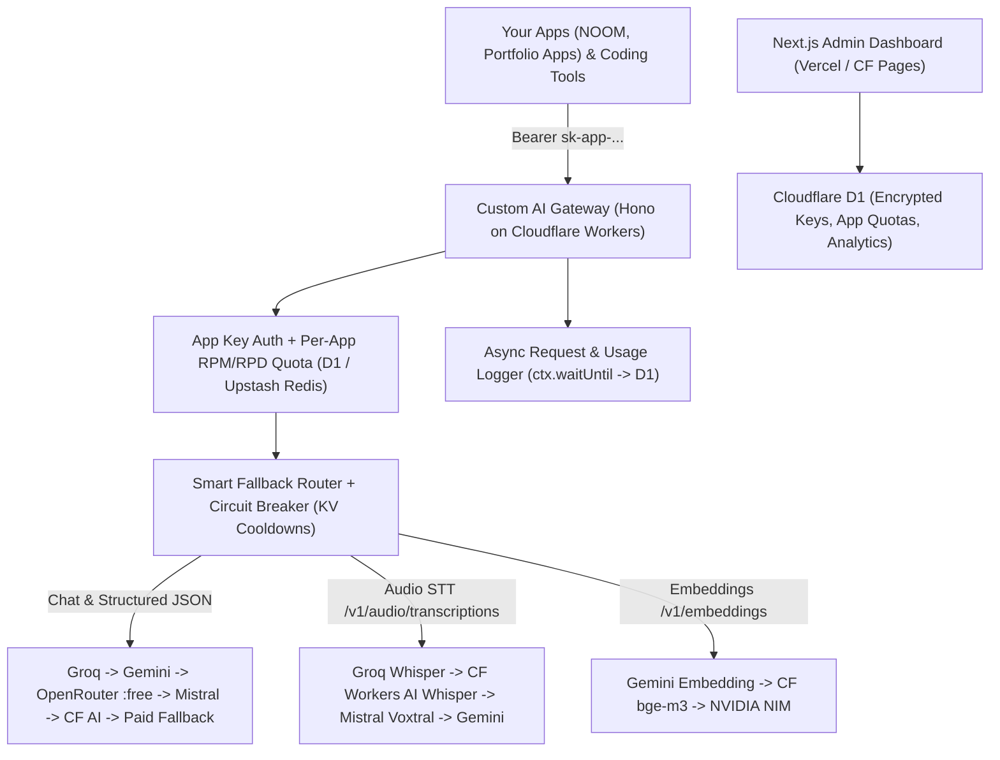

# AI Gateway Research & Architecture Report

> **Date:** November 2026  
> **Prepared for:** Personal & Portfolio AI Infrastructure (`ai-gateway`)  
> **Primary Stack:** TypeScript / JavaScript (Next.js, NestJS, Node.js)  
> **Core Constraint:** Stay strictly within **$0/month free tiers** (LLM providers + hosting), with clean extensibility to paid tiers later.  
> **Follow-up Deep-Dive:** See [ARCHITECTURE_AND_PROVIDERS_DEEP_DIVE.md](ARCHITECTURE_AND_PROVIDERS_DEEP_DIVE.md) for the **Cloudflare Workers (Hono + D1) vs. NestJS (Drizzle + Neon PG)** architecture breakdown, local `freellmapi` + `claude-free` setup guide, and the live-verified **Top 15 Free AI Providers (2026)** tier list.

---

## 1. Executive Summary & Verdict

### Does `tashfeenahmed/freellmapi` match what you want to build?

**Short answer: Yes — it is a ~90% match to your exact vision.**

[`tashfeenahmed/freellmapi`](https://github.com/tashfeenahmed/freellmapi) (55.6k+ stars, MIT license, TypeScript monorepo) was built specifically for the exact problem you described: **stacking official free tiers across dozens of AI providers behind a single universal `/v1` API with automatic failover, rate-limit tracking, encrypted keys, and full coding-agent support.**

However, deep code inspection of both `freellmapi` and your existing `noom` repository revealed **four critical gaps** where `freellmapi` does **not** fit your exact needs out-of-the-box:

1. **No per-app rate limits, quotas, or per-app analytics:** While `freellmapi` *does* let you mint separate per-app API keys (`sk-cp-...`), all keys share one global quota pool with no per-app caps or model restrictions. A single busy portfolio app (or a bot hitting a public demo) can exhaust all your free providers and starve your personal coding usage.
2. **NOOM's Gemini inline audio call breaks on `/v1beta` passthrough:** In `freellmapi`, the `/v1beta` Gemini adapter (`server/src/lib/gemini-wire.ts`) converts *all* `inlineData` parts into OpenAI `image_url` blocks. Pointing NOOM's current `GeminiTranscriptionProvider` directly at `freellmapi`'s `/v1beta` URL will fail. **The good news:** `freellmapi` natively supports `POST /v1/audio/transcriptions` across **13 free STT providers** (Groq Whisper, Cloudflare Workers AI, Mistral, Google, OVH, etc.) with timestamped `verbose_json` output — which pairs cleanly with NOOM's existing `TranscriptionProvider` port.
3. **Local-first, SQLite-backed architecture (not serverless-native):** Because `freellmapi` runs Express + `better-sqlite3` (native C++ addon), it cannot run on serverless edge platforms like Cloudflare Workers or Vercel Functions. Hosting it 24/7 for free requires either an **Oracle Cloud Always Free VPS** (best), a **PaaS container** like Render/Koyeb (cold starts + remote encrypted DB backups), or a **local machine + Cloudflare Tunnel**.
4. **No dollar-cost (`$`) budget guardrails for future paid tiers:** You *can* plug paid OpenAI/OpenRouter/DeepSeek keys into `freellmapi` as Custom OpenAI-compatible endpoints, and it tracks monthly request/token limits, but it does not calculate dollar spend or enforce hard `$` stop-losses.

### Quick Decision Matrix

| Strategic Path | Time to First Working API | Effort | Portfolio Showcase Value | Best If... |
| :--- | :--- | :--- | :--- | :--- |
| **Option A: Deploy `freellmapi` As-Is** | ~30 minutes | Low | Low (off-the-shelf tool) | You want free multi-provider AI immediately for coding + apps. |
| **Option B: Fork & Extend `freellmapi`** *(Recommended for fastest full solution)* | 1–3 days | Medium | Medium-High | You want 87 free providers + STT + coding CLI support **plus** per-app quotas, analytics, and cloud hardening. |
| **Option C: Build Custom TS Gateway from Scratch** *(Recommended as a flagship portfolio project)* | 1–2 weeks (MVP) | High | **Very High** | You want `ai-gateway` itself to be a standout TypeScript/Cloudflare/NestJS portfolio piece tailored 100% to your apps. |
| **Option D: Hybrid (Two-Tier Split)** *(Smartest operational isolation)* | 1 day + iterative | Medium | High | You run `freellmapi` **locally** for daily coding agents, and deploy a **lean cloud gateway** (forked or custom on Cloudflare Workers) strictly for your live portfolio apps. |

---

## 2. Context Audit: Your Stack & Existing App (`NOOM`)

Inspecting your sibling project in `noom` clarifies both your engineering style and your real-world AI requirements:

- **Your Stack:** Next.js 16 frontend + NestJS 11 backend (`Express 5`, `Drizzle ORM`, `PostgreSQL`, `Upstash Redis`, `Zod`, `Better Auth`), deployed with backend on **Render** and frontend proxying `/api/*`.
- **Clean Architecture Already in Place:** In `noom/noom-backend/src/ai/ai.port.ts` and `noom/noom-backend/src/ai/ai.module.ts`, you intentionally isolated AI behind a single `TRANSCRIPTION_PROVIDER` port. Swapping Gemini out for your AI Gateway requires **only one new adapter file + changing `useClass` in `ai.module.ts`** — zero changes to the rest of NOOM.
- **How NOOM Currently Calls AI (`noom/noom-backend/src/ai/gemini-transcription.provider.ts`):**
  - Browser extracts mono Opus audio (`audio/ogg`, capped at 5 min / ~1.2 MB).
  - Backend sends a single `fetch()` POST to Gemini's `/v1beta/models/{model}:generateContent` with base64 `inlineData`, `systemInstruction`, `responseMimeType: 'application/json'`, `responseSchema`, and `thinkingConfig: { thinkingLevel: 'low' }`.
  - Gemini returns timestamped `segments`, `chapters`, `summary`, `title`, and `language` in **one multimodal call**.
- **Why It Fails Today:** Single-vendor dependency on Google AI Studio's free tier means hitting Gemini's strict project-level RPD/RPM caps or transient `503`/`429` overloads completely breaks transcription with no fallback.

### Key Architectural Implication for Your AI Gateway
Your gateway cannot be "text chat only." To serve **NOOM** and future AI-heavy portfolio apps, your gateway needs:
1. **Chat / Text + Structured JSON Outputs** (summaries, chapters, resume analysis, agents, RAG).
2. **Speech-to-Text (`/v1/audio/transcriptions`)** with timestamped segments (`verbose_json`).
3. **Embeddings (`/v1/embeddings`)** and **Vision (`/v1/chat/completions` with `image_url`)** for future portfolio apps.
4. **Anthropic/OpenAI/Gemini protocol compatibility** so your daily coding tools (Claude Code, Cursor, Cline, Continue, Codex CLI, Gemini CLI) can use the same gateway.

---

## 3. Deep-Dive Analysis: `tashfeenahmed/freellmapi`

### 3.1 Repository Vitals & Tech Stack
- **Repository:** `https://github.com/tashfeenahmed/freellmapi` (Website: `https://freellmapi.co`)
- **Popularity & Health:** 55,684 stars, 7,929 forks, **MIT License**, actively maintained (commits as recent as Nov 2026).
- **Tech Stack (100% aligned with your JS/TS expertise):**
  - **Monorepo:** npm workspaces (`shared`, `server`, `client`, `cli`, `desktop`)
  - **Backend (`server/`):** TypeScript, **Express 5**, `better-sqlite3` (SQLite), `zod`, `multer`, `sharp`, `undici`, `vitest`
  - **Dashboard (`client/`):** React + Vite + shadcn/ui (60 languages, dark/light themes, playground, analytics, key manager, fallback chain editor)
  - **Security:** Provider keys encrypted at rest with **AES-256-GCM** (`ENCRYPTION_KEY`), decrypted in-memory per request; client keys hashed with SHA-256 and compared via constant-time HMAC (`timingSafeEqual`).
  - **Footprint:** ~40 MB RSS idle; multi-arch Docker image (`amd64` + `arm64`, runs on Raspberry Pi / small VPS) plus Windows/macOS/Linux Electron tray app.



### 3.2 What `freellmapi` Supports Well (Huge Wins for You)

| Capability | Implementation Verified in Codebase | Value to Your Goals |
| :--- | :--- | :--- |
| **Massive Free Provider Catalog** | 64+ built-in adapter files covering **87 free providers** / **1,313 endpoints** (1,137 chat, 29 image, 41 audio TTS, 68 embeddings, **19 transcription STT**, 6 video, 13 decision). | Saves months of reading docs and maintaining provider quirks. |
| **Universal Multi-Protocol API** | OpenAI (`/v1/chat/completions`, `/v1/responses`, `/v1/completions`, `/v1/embeddings`, `/v1/audio/transcriptions`, `/v1/audio/speech`, `/v1/images/generations`, `/v1/videos/generations`), Anthropic (`/v1/messages`), Gemini (`/v1beta`), Ollama (`/api/*`), Web Search (`/v1/search`), MCP (`/mcp`). | Works with OpenAI SDK, Vercel AI SDK, Claude Code, Cursor, Cline, Codex CLI, Gemini CLI, Zed, Continue, Aider. |
| **Smart Routing & Automatic Failover** | `server/src/services/router.ts` uses a Thompson-sampling bandit scoring reliability, latency (TTFB), capability, and quota headroom. Tracks RPM/RPD/TPM/TPD per `(platform, model, key)`, applies cooldowns on `429`/`5xx`, and fails over across up to 20 attempts within a wall-clock budget. | Directly solves your Gemini rate-limit & overload pain. |
| **Named Fallback Profiles (`auto:*`)** | Supports `auto`, `auto:fast`, `auto:smart`, `auto:reliable`, `auto:balanced`, and custom named chains (`auto:coding`, `auto:noom`) + response headers (`X-Routed-Via`, `X-Fallback-Trail`). | Lets different apps and coding tools request different model tiers through one URL. |
| **Speech-to-Text (`POST /v1/audio/transcriptions`)** | Built-in STT failover across **13 platforms** (`groq`, `cloudflare`, `mistral`, `google`, `ovh`, `typhoon`, `cohere`, `rime`, `cartesia`, etc.) + custom OpenAI-compat STT. Supports `verbose_json` (segments + timestamps), `json`, `text`, `vtt`. | Directly replaces Gemini-only transcription in **NOOM** with multi-provider failover. |
| **Per-Client API Keys (`sk-cp-...`)** | `server/src/routes/client-profiles.ts` lets you create, rotate, enable/disable, and delete separate keys per app, with optional server-enforced system prompts. | You don't have to share one master key across all portfolio apps. |
| **Custom OpenAI-Compatible Providers** | Supports adding any custom endpoint (Ollama, LM Studio, vLLM, or **paid** OpenAI/OpenRouter/DeepSeek/Anthropic relays) via dashboard or declarative JSON. | Future-proofs your requirement to optionally support paid tiers later. |
| **Declarative Config & Ephemeral Backups** | `FREEAPI_CONFIG_JSON` seeds keys/models idempotently on boot; `FREEAPI_DB_BACKUP_URL` encrypts and backs up/restores SQLite across restarts on ephemeral disks. | Makes deploying to free cloud hosts (Render/Koyeb) actually viable. |
| **Bonus Power Features** | Opt-in exact-match LRU response cache (zero quota on hit), opt-in prompt compression, tool-call argument rescue, sticky 30-min sessions, context handoff, and `fusion` multi-model synthesis. | Stretches free-tier quotas significantly further. |

### 3.3 What `freellmapi` Is NOT (Gaps & Caveats for Your Use Case)

1. **Not Multi-Tenant / No Per-App Rate Limits or Quotas:**
   - Verified in `server/src/lib/system-prompt.ts` and `server/src/routes/client-profiles.ts`: client profile keys (`sk-cp-...`) only store `name`, `token_hash`, `system_prompt`, and `enabled`.
   - There are **no per-key RPM/RPD/TPD caps**, **no per-key allowed model/profile restrictions**, and **no per-key analytics breakdown** in `routes/analytics.ts`.
   - *Risk:* If your public portfolio app gets traffic (or abuse), it can burn through your entire daily free-tier pool and leave your personal coding agents with `429 All models exhausted`.

2. **Not Hardened for Casual Public Internet Exposure:**
   - The README and `docs/en/architecture/00-high-level-index.md` explicitly state: *"Local-first. There's no multi-tenant auth. Run this for yourself; don't expose it to the internet."*
   - *Reality:* You **can** host it on a private VPS/PaaS for your own deployed backends (like NOOM on Render) **if** you put it behind HTTPS (Caddy/Nginx/Cloudflare), protect or block the `/api/*` admin dashboard from public access (e.g., Cloudflare Access or IP/header gate), and keep `/v1/*` strictly server-to-server (never calling it from browsers).

3. **Audio Inline-Data Bug/Gap on `/v1beta` Gemini Surface:**
   - Verified in `server/src/lib/gemini-wire.ts` (lines 329–339):
     ```ts
     if (inline?.mimeType && inline.data) {
       textBlocks.push({
         type: 'image_url',
         image_url: { url: `data:${inline.mimeType};base64,${inline.data}` },
       });
     }
     ```
   - Any `audio/ogg` payload sent to `/v1beta/models/...:generateContent` gets misclassified as an `image_url`, routed only to vision models, and fails. **Workaround:** Use `/v1/audio/transcriptions` + `/v1/chat/completions` instead (better anyway because it unlocks non-Gemini free STT providers like Groq Whisper!).

4. **30-Day Catalog Lag on Free Builds:**
   - `server/src/services/catalog-sync.ts` syncs a signed Ed25519 model catalog twice daily from `api.freellmapi.co`. Free installs receive the **monthly snapshot** (30 days behind live; currently ~303 newer models behind the paid `$19/yr` or `$49` lifetime live feed).
   - *Workaround:* Nothing expires or locks up; you can manually add new models via the dashboard, `FREEAPI_CONFIG_JSON`, or custom providers — and in a fork you can even point `CATALOG_BASE_URL` / `CATALOG_PUBKEY` at your own GitHub-hosted catalog JSON.

5. **No Native Paid-Tier Dollar Cost Accounting:**
   - Supports monthly request/token caps (`server/src/services/key-budget.ts`) and webhook alerts (Slack/Discord at 80%/100%), but has no per-token `$` pricing table or `$` hard spend limit for paid endpoints.

6. **Free-Tier Operational Realities:**
   - **End-of-day intelligence dip:** Top free models (e.g., Gemini Flash, DeepSeek, Kimi) exhaust their daily caps first, so the router gracefully falls down to smaller open models until UTC midnight reset.
   - **Zero SLA & Variable Latency:** Groq is sub-second; some smaller free providers queue for 10–30+ seconds.
   - **Terms of Service boundaries:** Free tiers are strictly for **single-user personal/developer/portfolio experimentation**. Do **not** resell access, share your gateway key with other people, or register multiple accounts per provider. (Also note: `freellmapi`'s own ToS audit advises avoiding **Cohere** for personal/consumer use and notes **NVIDIA NIM** is evaluation-only and **Google Gemini** free tier trains on prompts.)

---

## 4. Open-Source & Managed AI Gateway Alternatives (2026 Landscape)

To ensure you don't tunnel-vision on a single repo, here is how `freellmapi` compares against the best open-source and free-tier-friendly AI gateways in 2026:

| Project / Service | Stack | License | Free-Tier Aggregation Built-In? | Multi-App Keys & Quotas | Audio STT Failover | Free Serverless / Edge Hosting? | Best Fit |
| :--- | :--- | :--- | :--- | :--- | :--- | :--- | :--- |
| **[FreeLLMAPI](https://github.com/tashfeenahmed/freellmapi)** | TypeScript (Express + React + SQLite) | MIT | **Yes (87 providers)** | Keys yes (`sk-cp-`); quotas **no** | **Yes (13 providers)** | No (needs Node/Docker/VPS) | Stacking free tiers + personal coding agents |
| **[Portkey Gateway](https://github.com/Portkey-AI/gateway)** | TypeScript (Node / Bun / **CF Workers**) | MIT | No (BYOK manual config) | Paid cloud only (OSS is stateless) | Passthrough only | **Yes (Cloudflare Workers)** | Ultra-lightweight TS edge proxy with retries/fallbacks |
| **[LiteLLM Proxy](https://github.com/BerriAI/litellm)** | Python (FastAPI + Postgres + Redis) | MIT (Enterprise features paid) | No (100+ providers, manual YAML) | **Yes (Virtual Keys, RPM/TPM, `$` budgets)** | Yes (OpenAI/Groq/etc.) | No (heavy; needs Postgres + Redis) | Multi-app governance & `$` cost tracking (Python stack) |
| **[New-API](https://github.com/QuantumNous/new-api)** *(One-API successor)* | Go + React (SQLite/MySQL/PG) | **AGPLv3** | Partial (manual channels) | **Yes (Users, Tokens, Quotas, Billing)** | Yes | No (needs VPS/Docker) | Multi-app token/quota management + OpenAI/Claude/Gemini translation |
| **[Bifrost](https://github.com/maximhq/bifrost)** | Go | Apache 2.0 | No | Yes (Budgets & MCP) | Partial | No (Go binary/Docker) | High-throughput enterprise proxy |
| **[LLMGateway](https://github.com/theopenco/llmgateway)** | TypeScript / Next.js | Open Source | No (BYOK + unified billing) | Yes | Partial | Needs PG/Redis | Modern TS SaaS-style AI gateway |
| **[Cloudflare AI Gateway](https://developers.cloudflare.com/ai-gateway/)** | Managed Edge Service | Free Tier (Closed) | No (wraps your provider keys) | Gateway-level rate limiting | Passthrough | **Yes (100% Managed Free)** | Zero-ops caching, analytics, & fallback layer in front of providers |
| **Custom TS Gateway (Hono + CF Workers + D1)** | TypeScript (Hono + Vercel AI SDK) | Yours | You curate your top 6–10 | **100% custom to your needs** | **Yes (Groq + CF + Gemini)** | **Yes (100k req/day free, 0ms cold start)** | Portfolio centerpiece + zero-cost 24/7 app backend |

### Notable Mentions Worth Knowing (and Avoiding)
- **`free-llm-api-resources` (`cheahjs/free-llm-api-resources` / community lists):** Not a gateway itself, but the best open-source reference list of active free-tier providers and quotas if you build your own gateway or maintain a fork's catalog.
- **`CLIProxyAPI` (`router-for-me/CLIProxyAPI`):** Wraps consumer chat/CLI subscriptions (Claude, ChatGPT, Gemini CLI) into API endpoints. **Caution:** High risk of account bans and brittle breakage compared to using official developer free-tier API keys.

---

## 5. Free-Tier AI Provider Landscape (2026 Reality Check)

You do **not** need to register 87 accounts on day one. Starting with **6–7 high-signal, zero-credit-card providers** gives you huge reliability, speed, multimodal support, and audio transcription:

| Provider | Card Required? | Free-Tier Strengths | Key Limits & Caveats (2026) | ToS & Privacy Notes |
| :--- | :--- | :--- | :--- | :--- |
| **Groq (GroqCloud)** | No | Ultra-fast Llama/Qwen/GPT-OSS chat + **Whisper Large v3 & v3-turbo STT** | ~30 RPM, 1,000 RPD, 6k–8k TPM, 200k TPD (model-dependent). Tight TPM for huge prompts. | ✅ Permits app integration. Great primary STT for NOOM! |
| **Google AI Studio (Gemini)** | No | Strong multimodal (text, vision, audio), huge context, `gemini-embedding-001` | Strict dynamic RPD/RPM per project (not per key); occasional overload. | ⚠️ Free tier prompts/responses may be used to train Google models. |
| **OpenRouter (`:free`)** | No | Single key unlocks dozens of free open models (`:free` suffix) | 20 RPM, **50 RPD** free — permanently unlocks **1,000 RPD** if you ever make a one-time $10 credit top-up (never expires monthly). Frequent upstream `429`s during peak hours. | ✅ Private personal/app proxy OK; no reselling. |
| **Cloudflare Workers AI** | No | 10,000 neurons/day free: Whisper STT, `bge-m3` embeddings, Llama/Qwen text, image gen | Metered in neurons (must cap at ~9,000/day so you never trigger overages if card is ever added). | ✅ Great reliable fallback for STT + embeddings. |
| **Mistral (La Plateforme)** | No | Good general + coding models + audio transcription | Strict **1 RPS** global workspace limit; small bursts trigger `429`. | ✅ Good for steady background jobs, not parallel bursts. |
| **NVIDIA NIM** | No | Recurring **40 RPM** free access to large open models & embeddings | Slower cold prefill on big reasoning models; requires higher timeout. | ⚠️ Evaluation/non-production ToS — best for personal dev/testing. |
| **OVH AI Endpoints / HuggingFace** | No | Extra fallback cushion (OVH even supports anonymous low-RPM access; HF supports embeddings/media) | Lower rate limits / occasional queues. | ✅ Good bottom-of-chain safety net. |

> **Important 2026 Changes to Watch Out For:**
> - **GitHub Models** has been **officially retired** — ignore older tutorials recommending it.
> - **Cerebras** shifted from a permanently free API tier to a **one-time $5 / 30-day promotional credit requiring a payment card**. Don't build permanent `$0` assumptions around it.

---

## 6. Hosting Your AI Gateway for $0/month

Your gateway needs to be reachable by **both** your deployed portfolio backends (e.g., NOOM on Render, Next.js apps on Vercel) **and** your local development machine. Here is the honest 2026 breakdown of `$0/month` hosting:

| Platform | Monthly Cost | Cold Starts? | Persistent Disk for SQLite? | Works with `freellmapi`? | Works with Custom TS/Hono Gateway? | Verdict |
| :--- | :--- | :--- | :--- | :--- | :--- | :--- |
| **Oracle Cloud (OCI) Always Free ARM VPS** | $0 forever (up to 4 OCPU / 24 GB RAM) | **None (24/7)** | **Yes (full Linux disk)** | **Yes (Docker + Caddy HTTPS)** | **Yes** | **Best overall for 24/7 `freellmapi`**, *if* you pass Oracle's strict card verification during signup. |
| **Cloudflare Workers + D1 + KV** | $0 forever (100k req/day) | **None (~0ms edge)** | **Yes (D1 serverless SQLite)** | **No** (Express + native `better-sqlite3` unsupported) | **Yes (Native!)** | **Best overall zero-ops free hosting** if you build a custom Hono gateway (or deploy Portkey). |
| **Render Free Web Service** | $0 | **Yes (~30–50s after 15m idle)** | **No** (ephemeral on free tier) | **Yes** (with `FREEAPI_DB_BACKUP_URL` + `FREEAPI_CONFIG_JSON`) | **Yes** | Easy Docker deploy (matches your NOOM backend host), but cold starts hurt interactive chat UX and coding agents. |
| **Koyeb Free** | $0 | **Yes (after 1h idle)** | **No** (ephemeral) | **Yes** (with backup URL / declarative config) | **Yes** | Similar to Render; slightly longer idle window (1h). |
| **Local PC / Raspberry Pi + Cloudflare Tunnel** | $0 | **None while PC is on** | **Yes** | **Yes (Ideal!)** | **Yes** | Zero latency for local coding; public HTTPS via `cloudflared`, but portfolio demos go down if your PC sleeps. |
| **Fly.io** | Paid only | — | — | Paid | Paid | **No longer offers a free tier for new accounts.** |

### The "Cold Start + Ephemeral Disk" Workaround (If Using Render/Koyeb Free)
If you deploy `freellmapi` on Render's free tier (where NOOM already lives):
- Provide `FREEAPI_CONFIG_JSON` (declarative keys + models) and/or `FREEAPI_DB_BACKUP_URL` (encrypted SQLite backup pushed to a free Cloudflare R2 bucket / Supabase / S3 endpoint) so restarts never wipe your keys or analytics.
- Note that Render's 30–50s cold start is tolerable for **background async jobs** (like NOOM video transcription!), **not** for real-time coding autocomplete — which is why running a **local instance** for coding is so much better.

---

## 7. Your 4 Strategic Options (Detailed Breakdown)

### Option A: Deploy `freellmapi` As-Is (Fastest Win — 30 Minutes)
- **Setup:** Install the Windows Desktop app (Microsoft Store) or run `docker compose up -d` locally for your coding tools; optionally deploy the official `ghcr.io/tashfeenahmed/freellmapi:latest` Docker image to an Oracle Free VPS (or Render free tier) for your deployed apps.
- **Pros:** Zero code to maintain, instant access to 87 providers + 13 STT providers, automatic upstream bug fixes.
- **Cons:** No per-app rate limits/quotas, no per-app analytics, 30-day catalog lag on free tier, doesn't add a custom project to your portfolio.

---

### Option B: Fork `freellmapi` & Build Targeted Extensions *(Best 80/20 Engineering Path)*

Because `freellmapi` is MIT-licensed and written cleanly in **TypeScript + Express 5 + React + SQLite**, you can fork it into your workspace (`ai-gateway`) and build **only the missing 10%** that turns it from a local single-user proxy into your **personal multi-app cloud AI gateway**:

#### Concrete Fork Roadmap (With Exact Code Touchpoints)

1. **Per-App Quotas, Rate Limits & Model Scoping (`client_profiles`)**
   - *Where:* `server/src/db/migrate/` (new migration), `server/src/routes/client-profiles.ts`, `server/src/lib/system-prompt.ts`, `server/src/routes/proxy.ts`.
   - *Add columns to `client_profiles`:* `max_rpm`, `max_rpd`, `max_tpd`, `allowed_chain` (e.g., pin NOOM's key strictly to `auto:noom`), `allow_paid_fallback` (boolean).
   - *Why it matters:* Guarantees a public portfolio demo can NEVER drain your personal coding quota!
2. **Per-App Analytics & Request Attribution**
   - *Where:* `requests` table (`client_profile_id`), `server/src/routes/proxy.ts`, `server/src/routes/analytics.ts`, and `client/` Analytics page.
   - *Benefit:* See exact request volume, latency, error rates, and token usage broken down by app (`noom`, `resume-analyzer`, `coding-local`, etc.).
3. **Paid-Tier Last-Resort Fallback + Hard `$` Spend Cap**
   - *Where:* `server/src/services/key-budget.ts`, `server/src/services/router.ts`.
   - *Add:* `is_paid` flag + `input_cost_per_1m` / `output_cost_per_1m` + `monthly_usd_cap` on custom provider keys. Route to paid keys **only** after all free candidates fail (or when explicitly requested via `auto:paid`), and hard-block once monthly estimated spend reaches your cap (e.g., `$0.00` or `$2.00`).
4. **Public Cloud Admin Hardening**
   - *Where:* `server/src/middleware/requireAuth.ts` and Express app entry (`server/src/index.ts`).
   - *Add:* `DISABLE_PUBLIC_DASHBOARD=true` or `ADMIN_SHARED_SECRET` header / Cloudflare Access JWT verification so `/api/*` admin routes cannot even be probed on the public internet, while `/v1/*` accepts your backend apps' `sk-cp-...` bearer tokens.
5. **Fix Gemini `/v1beta` Audio Passthrough (Optional)**
   - *Where:* `server/src/lib/gemini-wire.ts` (lines 329–339).
   - *Fix:* Only map `inlineData` to `image_url` when `mimeType.startsWith('image/')`; preserve `audio/*` blocks when forwarding to native Gemini upstream.

> **Upstream Sync Tip:** Keep your fork changes isolated in clean modules/migrations so you can periodically `git merge upstream/main` to pull in new free provider adapters and quirk fixes!

---

### Option C: Build Your Own Custom TypeScript AI Gateway *(Best Portfolio Showcase & Serverless $0 Architecture)*

If you want **`ai-gateway` itself to be a flagship portfolio project** — AND you want **true $0/month, 24/7, zero-cold-start global edge hosting** without managing a VPS — building a lean, focused TypeScript gateway from scratch on **Cloudflare Workers + Hono + D1 (SQLite) + Upstash Redis/KV** (or **NestJS + Drizzle + Postgres** matching NOOM) is an awesome choice!

#### Why Building Your Own Can Actually Be Cleaner Than Forking 1,441 Files
- `freellmapi` has 1,441 files (Electron desktop app, 60 i18n languages, 64 obscure providers, video gen, Watchtower, MCP tunnel, etc.).
- Your apps realistically only need **6–8 rock-solid free providers** (Groq, Gemini, OpenRouter, Cloudflare Workers AI, Mistral, NVIDIA NIM + Custom OpenAI-compat for paid/local).
- Running natively on **Cloudflare Workers** gives you:
  - **$0/month forever** (100,000 requests/day free)
  - **0ms cold starts** (no Render 45-second wakeups!)
  - **Built-in D1 SQLite** + **Cloudflare Workers AI binding** (native access to Whisper STT, Llama, and `bge-m3` embeddings directly inside the Worker!)
  - **Next.js Admin Dashboard** (your superpower!) deployed free on Vercel or Cloudflare Pages.

#### Recommended Custom Architecture (`Hono` + `Cloudflare Workers`)



#### Phased MVP Roadmap (Custom Build)
- **Phase 1 (Weekend 1 — Core Proxy & Failover):** Hono on Cloudflare Workers exposing `POST /v1/chat/completions` (streaming SSE + non-streaming + JSON schema) and `GET /v1/models`. Plug in Groq, Gemini, OpenRouter, Mistral, and Cloudflare AI with automatic `429`/`5xx` failover and KV cooldowns.
- **Phase 2 (Week 2 — NOOM Support & Per-App Keys):** Add `POST /v1/audio/transcriptions` (Groq Whisper + Cloudflare Whisper with `verbose_json` timestamps), AES-GCM encrypted key storage in D1, and per-app API keys with RPM/RPD limits + allowed profiles.
- **Phase 3 (Week 3 — Dashboard & Coding Tools):** Build a clean Next.js dashboard (manage keys, live provider health, per-app usage charts, fallback order, playground) + add `/v1/messages` (Anthropic translation) so Claude Code & Cursor work seamlessly.
- **Phase 4 (Optional — Paid Safety Net):** Add optional paid provider keys with per-token cost calculation and hard monthly `$` circuit breaker.

> **Cloudflare Workers Free-Tier Gotcha to Design Around:** Cloudflare Workers Free has a **10 ms CPU time limit per request** (note: *waiting* on `fetch()` I/O to LLM APIs does **not** count toward CPU time — streaming SSE passes through in <2ms CPU! Just avoid heavy synchronous image/audio transcoding inside the Worker, which NOOM already handles in the browser!). Also note Workers Free caps outgoing subrequests at **50 per invocation**, which is plenty for a 5–8 provider fallback chain.

---

### Option D: Hybrid Two-Instance Architecture *(Highest Practical Reliability)*

This combines the best of Options A and C (or B) with **zero compromise**:
1. **For your daily coding usage (Claude Code, Cursor, Cline, Continue, Codex CLI):**
   - Run **`freellmapi` locally** (Windows Microsoft Store app or Docker on `localhost:3001`).
   - Zero latency, zero hosting bills, instant access to 87 free providers + Anthropic/Gemini/Ollama surfaces + prompt compression + 1-command CLI setup.
2. **For your deployed portfolio applications (NOOM, Resume Analyzer, future Next.js/NestJS apps):**
   - Build & deploy **your own clean TypeScript AI Gateway on Cloudflare Workers (Option C)** — *or* deploy a hardened **fork of `freellmapi` on Oracle Cloud Always Free VPS (Option B)**.
   - Your live portfolio apps get 24/7 availability, strict per-app quotas, and complete isolation from your personal coding quota!

---

## 8. Integration Blueprint: Using the Gateway in Your Apps

### Golden Security Rule
**Never call your AI Gateway directly from browser/client-side code.** Even with per-app keys, exposing a gateway key in `NEXT_PUBLIC_*` lets anyone steal it and burn all your free tiers. Always call the gateway **server-to-server** from:
- NestJS services (`noom-backend`)
- Next.js Route Handlers (`app/api/**/route.ts`) or Server Actions

---

### 8.1 Concrete Plan for Migrating `NOOM` (`noom-backend`)

Because you already built the clean `TranscriptionProvider` port in `noom/noom-backend/src/ai/ai.port.ts`, migrating NOOM off single-key Gemini takes **one new NestJS provider class** (`gateway-transcription.provider.ts`):

#### Recommended 2-Step Resilient Pipeline (Zero Single-Provider Risk)
1. **Step 1 — Speech-to-Text (`POST {AI_GATEWAY_URL}/v1/audio/transcriptions`)**
   - Send `request.audio` (`audio/ogg` Opus buffer) as `multipart/form-data` with `model: "auto"` and `response_format: "verbose_json"`.
   - Gateway automatically routes to **Groq Whisper Large v3** (blazing fast, free) → falls back to **Cloudflare Workers AI Whisper** → **Mistral** → **Google** → **OVH**.
   - Returns `{ language, text, segments: [{ start, end, text }] }`.
2. **Step 2 — Chapters, Summary & Title (`POST {AI_GATEWAY_URL}/v1/chat/completions`)**
   - Pass the compact timestamped transcript text to `model: "auto:noom"` (or `"auto:fast"`) with `response_format: { type: "json_schema", ... }` matching your existing Zod schema in `transcript.schema.ts`.
   - Gateway routes across Gemini Flash / Groq Llama / Mistral / OpenRouter `:free` with automatic failover!
3. **Optional Bonus Pattern:** Keep `GeminiTranscriptionProvider` as an optional fast-path when `GENAI_API_KEY` is healthy, and catch `429`/`5xx`/`timed_out` to automatically fall back to `GatewayTranscriptionProvider`!

```ts
// Example env vars in noom-backend (replaces single GENAI_API_KEY dependency)
AI_GATEWAY_URL=https://ai-gateway.yourdomain.com/v1
AI_GATEWAY_API_KEY=sk-cp-noom-xxxx          // Dedicated revocable key for NOOM
AI_GATEWAY_CHAT_MODEL=auto:noom             // Named fallback profile
AI_GATEWAY_STT_MODEL=auto                   // Multi-provider STT chain
```

---

### 8.2 Future Next.js & NestJS Portfolio Apps (Universal Drop-In)

Because your gateway speaks standard **OpenAI `/v1`**, every future JS/TS app connects with **zero vendor lock-in** using either the official `openai` package or the **Vercel AI SDK**:

#### Option 1: Official OpenAI SDK (Node.js / NestJS / Next.js)
```ts
import OpenAI from 'openai';

export const ai = new OpenAI({
  baseURL: process.env.AI_GATEWAY_URL,      // e.g. https://gw.yourdomain.com/v1
  apiKey: process.env.AI_GATEWAY_API_KEY,   // per-app key
});

const res = await ai.chat.completions.create({
  model: 'auto:fast',
  messages: [{ role: 'user', content: 'Analyze this resume...' }],
});
```

#### Option 2: Vercel AI SDK (`ai` + `@ai-sdk/openai-compatible`) — Ideal for Next.js Streaming UI
```ts
import { createOpenAICompatible } from '@ai-sdk/openai-compatible';
import { streamText } from 'ai';

const gateway = createOpenAICompatible({
  name: 'my-ai-gateway',
  baseURL: process.env.AI_GATEWAY_URL!,
  apiKey: process.env.AI_GATEWAY_API_KEY!,
});

const result = streamText({
  model: gateway('auto:balanced'),
  prompt: 'Stream a structured breakdown...',
});
```

### 8.3 Daily Coding Agents (Claude Code, Cursor, Cline, Continue, Codex CLI)
- If running **FreeLLMAPI** (Options A, B, or D), setup is literally a single command:
  ```bash
  npx freellmapi setup-claude --url http://localhost:3001 --api-key freellmapi-your-key
  ```
- For **Cursor / Cline / Roo Code / Continue**: set Provider = `OpenAI Compatible`, Base URL = `http://localhost:3001/v1` (or your cloud URL), API Key = your unified/coding key, Model = `auto:coding`.

---

## 9. Recommended Action Plan

If you want the **highest leverage with zero wasted effort**, follow this sequence:

1. **Today (30 mins) — Validate Free-Tier Stacking Immediately:**
   - Sign up for free API keys (no credit card) at the **Core 5**: **Groq**, **Google AI Studio**, **OpenRouter**, **Mistral**, and **Cloudflare Workers AI** (plus **NVIDIA NIM** for extra coding capacity).
   - Spin up `freellmapi` locally (via Docker or Windows Desktop app) and test both your coding tools and a sample `curl` to `/v1/audio/transcriptions` with a short `.ogg` clip from NOOM.
2. **Choose Your Build Direction for `ai-gateway`:**
   - **Choose Option B (Fork `freellmapi`)** if your priority is getting all 87 providers + STT + coding agents deployed fast, and adding **per-app quotas, per-app analytics, and paid-tier `$` safety caps** in TypeScript. Host it on **Oracle Cloud Always Free VPS** (or Render Free + encrypted backup URL).
   - **Choose Option C (Build Custom Hono + Cloudflare Workers + D1 Gateway)** if you want `ai-gateway` to be a **clean, modern, zero-cold-start portfolio project** tailored to your Next.js/NestJS apps (while optionally keeping `freellmapi` locally for your personal coding tools — **Option D**).
3. **First Real Integration Target — `NOOM`:**
   - Implement `GatewayTranscriptionProvider` behind `noom-backend/src/ai/ai.port.ts` using the 2-step `/v1/audio/transcriptions` + `/v1/chat/completions` flow and verify end-to-end resilience when Gemini is rate-limited.
