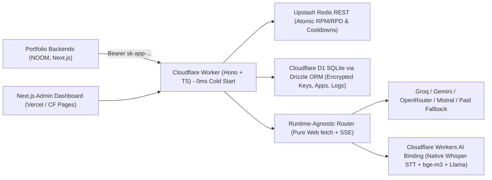
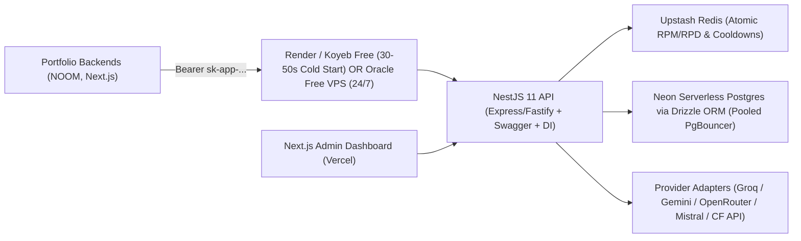

# Option D Deep-Dive: Custom AI Gateway Architecture, Local `freellmapi` + Claude Code Setup, and Top 15 Free Providers (2026)

> **Companion to:** [AI_GATEWAY_RESEARCH_REPORT.md](AI_GATEWAY_RESEARCH_REPORT.md)  
> **Strategy:** **Option D (Hybrid Split)** — Run `tashfeenahmed/freellmapi` **locally** for daily coding agents (Claude Code, Codex, Cline, etc.), and build **your own custom TypeScript AI Gateway (Option C)** for your deployed portfolio apps (`NOOM` + future Next.js/NestJS projects).

---

## Part 1: Custom AI Gateway Architecture — Cloudflare Workers (`Hono + D1`) vs. NestJS (`NestJS + Drizzle + Postgres`)

Both options are 100% TypeScript and even share **Drizzle ORM**, **Zod**, and **Upstash Redis**. The real difference comes down to **runtime model, `$0/month` hosting behavior, cold starts, and portfolio differentiation**.

### 1.1 Side-by-Side Architecture Blueprints

#### Approach 1: Cloudflare Workers + Hono + Drizzle (D1) + Upstash Redis


#### Approach 2: NestJS + Drizzle + Neon PostgreSQL + Upstash Redis


---

### 1.2 Head-to-Head Technical Comparison (2026 `$0/month` Reality)

| Dimension | Approach 1: **Cloudflare Workers + Hono + D1** | Approach 2: **NestJS + Drizzle + Neon PG** |
| :--- | :--- | :--- |
| **`$0/month` Hosting & Cold Starts** | **Best-in-class.** 100,000 req/day free forever, **~0 ms cold starts**, globally distributed edge, never sleeps. | **Major catch on free PaaS:** Render/Koyeb free containers sleep after 15m–1h (**30–50s cold start**) + Neon wakes in ~300ms ("double cold start"). **Only** avoids cold starts if you pass **Oracle Cloud Always Free VPS** signup verification. |
| **Streaming SSE (Chat Completions)** | **Works cleanly.** Workers Free has a **10 ms CPU time limit**, *not* a wall-clock limit — waiting on upstream `fetch()` and piping SSE chunks via `TransformStream` is network I/O and consumes ~1–2 ms CPU total. | **Unconstrained.** Full Node.js sockets, arbitrary CPU/memory per stream, zero subrequest caps. |
| **Audio Multipart Uploads (`NOOM`)** | **Works cleanly for NOOM.** Cloudflare Free accepts up to **100 MB** request bodies (128 MB isolate RAM); NOOM's audio is ~1.2 MB Opus. Just forward the `FormData`/`Blob` to Groq/CF Whisper without doing CPU-heavy transcoding inside the Worker. | **Unconstrained.** Can run `multer`, stream arbitrary file sizes, or even invoke `ffmpeg`/`sharp` if you ever want server-side transcoding. |
| **Database & ORM** | **Drizzle ORM (`drizzle-orm/d1`)** over Cloudflare D1 (serverless SQLite, generous free daily reads/writes, zero connection pooler needed). | **Drizzle ORM (`drizzle-orm/node-postgres`)** over **Neon Free Postgres** (1 GB storage, 100 compute hrs/mo, auto-wakes; better than Supabase free which pauses after 7 days idle). Must use `-pooler` URL. |
| **Rate Limiting & Circuit Breakers** | ⚠️ **Important Trap:** Do **NOT** use Cloudflare KV for rate limiting (KV Free caps at **1,000 writes/day**!). Use **Upstash Redis REST (`@upstash/redis`)** (10,000 req/day free, atomic `INCR`/`EXPIRE`, pure `fetch()` so ~0ms CPU). | **Upstash Redis (`@upstash/redis`)** works identically (you already use it in `NOOM`!). |
| **Built-in Free AI Bonus** | **Huge edge win:** Direct `env.AI.run()` binding to **Cloudflare Workers AI** (10,000 neurons/day free for Whisper STT, `bge-m3` embeddings, Llama/Qwen) — zero external HTTP hop or extra API key! | Must call Cloudflare Workers AI over REST with `account_id` + API token (still works fine, just an extra hop). |
| **CPU & Subrequest Limits** | **10 ms CPU/request** and **50 subrequests/request** on Free tier. Plenty for a 6–8 provider fallback chain + Redis check + D1 write (`ctx.waitUntil`), *but* blocks heavy CPU work (image resizing, PDF parsing, local tokenization). | **No artificial 10ms CPU or subrequest caps.** Can run background cron jobs (`@nestjs/schedule`), periodic key health checks, PDF/image preprocessing, and OpenAPI/Swagger generation natively. |
| **Developer Experience (For You)** | Slight learning curve (`Hono`, `wrangler`, Web Crypto API instead of Node `crypto`), **but** super clean, minimal boilerplate, sub-second local reloads, and Drizzle + Zod feel right at home. | **Maximum comfort.** Identical to `noom-backend` (NestJS 11 + Drizzle + Zod + Upstash Redis + Vitest). You can reuse your exact patterns and folder conventions. |
| **Portfolio & Resume Signal** | **Expands your breadth.** Since `NOOM` already proves NestJS + Drizzle + Postgres + Render, an **Edge/Serverless AI Gateway on Cloudflare Workers + Hono + D1** shows recruiters you master *both* traditional backends **and** modern edge infrastructure. | **Deepens enterprise NestJS mastery.** Strong showcase of NestJS architecture, DI, interceptors, guards, OpenAPI, and Postgres modeling—though overlaps visually with `NOOM`'s stack. |

---

### 1.3 Deep-Dive Pros & Cons

#### Approach 1: Cloudflare Workers + Hono + D1 + Upstash Redis
- **Pros:**
  - **Zero cold starts at `$0/month`:** When a recruiter opens one of your live portfolio apps (e.g., an AI chat demo or NOOM transcription), the gateway responds immediately instead of stalling for 45 seconds waiting for Render to wake up.
  - **Native Cloudflare Workers AI binding:** Free Whisper STT + embeddings + LLMs built right into the runtime.
  - **Zero infrastructure babysitting:** No Linux patching, no PgBouncer pool tuning, no container sleep hacks, `wrangler deploy` takes 5 seconds.
  - **Portfolio differentiation:** Hono + Cloudflare Workers + D1 + SSE streaming + AES-GCM Web Crypto + Upstash Redis is a genuinely modern, impressive engineering stack.
- **Cons:**
  - **10 ms CPU ceiling on Free tier:** You must write clean, streaming-first code (no giant synchronous JSON transforms, no `sharp`/`ffmpeg`, no heavy `tiktoken` WASM tokenizers—use lightweight char/4 token estimation + upstream `usage` headers).
  - **No long-lived in-memory state:** Cooldowns and rate limits *must* live in Upstash Redis (or D1), not JS `Map`s in RAM.
  - **Cron triggers on Free tier:** Workers Free allows up to 5 cron triggers (great for periodic provider health checks!), though each cron is still bound by CPU time.

#### Approach 2: NestJS + Drizzle + Neon PostgreSQL + Upstash Redis
- **Pros:**
  - **Zero friction with your existing skills:** Mirrors `noom-backend` almost 1:1 (NestJS modules, Guards for API key auth, Interceptors for latency/token logging, Pipes for Zod validation, Swagger `/docs` out of the box).
  - **No 10ms CPU or 50-subrequest constraints:** Easy to add heavier features later (prompt compression, PDF text extraction, real tokenizers, complex background health probes, multi-provider fusion fan-out).
  - **PostgreSQL power:** Richer analytics queries (`date_trunc`, window functions, JSONB) in Neon Postgres than SQLite/D1.
- **Cons:**
  - **The `$0/month` hosting bottleneck:** Unless you get an **Oracle Cloud Always Free VPS** (which notoriously rejects many debit/credit cards during signup verification), running NestJS free on **Render or Koyeb means 30–50 second cold starts**! That breaks real-time streaming chat UX and causes upstream client timeouts (like NOOM's `AbortSignal.timeout`).
  - **More moving parts:** Render/Koyeb container + Neon PgBouncer pooling + Upstash Redis + cold-start retry handling.

---

### 1.4 Clear Recommendation for Option C

> **Winner: Approach 1 — Cloudflare Workers + Hono + Drizzle (D1) + Upstash Redis**  
> *(With one smart engineering safeguard: put your routing, failover, and provider adapter logic in a runtime-agnostic `packages/core` folder using pure Web `fetch()` and Web Crypto!)*

**Why this wins for you:**
1. **Your `$0/month` constraint makes cold starts the #1 dealbreaker.** A gateway sits in the critical path of *every* AI feature across *every* portfolio app you build. A 45-second Render cold start will make your AI apps feel broken in live demos. Cloudflare Workers solves this permanently for `$0`.
2. **You don't lose your Drizzle/TS superpowers:** Hono + Drizzle (`d1`) + Zod + Upstash Redis + a **Next.js Admin Dashboard** lets you use 80% of the stack you already love while adding **Edge Computing / Cloudflare Workers** to your resume (complementing `NOOM`'s NestJS + Postgres stack).
3. **Zero lock-in with a monorepo split:** If you structure the repo as:
   - `packages/core` — pure TypeScript (provider adapters, fallback router, OpenAI/Anthropic wire translators, AES-GCM Web Crypto) using only Web Standards (`fetch`, `ReadableStream`, `crypto.subtle`)
   - `apps/gateway-edge` — thin Hono entrypoint on Cloudflare Workers + D1 + Upstash
   - `apps/dashboard` — Next.js admin UI (manage keys, per-app quotas, fallback chains, analytics, playground)
   
   ...then if you *ever* outgrow Cloudflare Workers Free (or grab an Oracle VPS later), you can drop `packages/core` straight into a NestJS/Node container in a single afternoon!

*(Only pick **Approach 2: NestJS** from Day 1 if you already have an always-on **Oracle Cloud Always Free VPS** running Docker and specifically want to keep everything in NestJS.)*

---

## Part 2: Local `freellmapi` Setup + Using Claude Code & Other Coding CLIs Safely

This is the **local half of Option D**: running `tashfeenahmed/freellmapi` strictly on your Windows machine for your personal coding agents, **without touching or breaking your default Claude Code setup**.

### 2.1 Installing & Running `freellmapi` Locally on Windows

You have two clean options:

- **Option 1 — Windows Desktop App (Easiest & Recommended for Daily Coding):**
  1. Install **FreeLLMAPI** from the [Microsoft Store](https://apps.microsoft.com/detail/9PBN6G8K2B7F) (signed, auto-updates, runs quietly in your system tray).
  2. It starts automatically on **`http://127.0.0.1:31415`** with no login password required on localhost.
  3. Open the tray icon → **Open Dashboard** → add your Tier 1 provider keys on the **Keys** page → copy your **unified API key** (`freellmapi-...`) from the header.
- **Option 2 — Docker Compose (If you prefer running it in Docker):**
  ```powershell
  git clone https://github.com/tashfeenahmed/freellmapi.git
  cd freellmapi
  $Bytes = New-Object Byte[] 32
  [Security.Cryptography.RandomNumberGenerator]::Create().GetBytes($Bytes)
  $ENCRYPTION_KEY = -join ($Bytes | ForEach-Object { "{0:x2}" -f $_ })
  "ENCRYPTION_KEY=$ENCRYPTION_KEY`nPORT=3001" | Out-File -Encoding utf8 .env
  docker compose up -d
  ```
  *(Dashboard & API live at `http://localhost:3001`.)*

> **Note the port difference:** Desktop app uses **`http://127.0.0.1:31415`**; Docker/source uses **`http://localhost:3001`**. Adjust the URL below depending on which you install.

---

### 2.2 Setting Up a Separate `claude-free` Command (Leaving Normal `claude` 100% Untouched!)

Do **NOT** run plain `npx freellmapi setup-claude` without `--profile` if you want to keep your regular Anthropic Claude Code login as the default `claude` command. Instead, use one of these **two clean isolation methods**:

#### Method A (Best Daily DX): Add a `claude-free` Function to Your PowerShell `$PROFILE`

Open your PowerShell profile (`notepad $PROFILE`) and add:

```powershell
# Launch Claude Code routed through local FreeLLMAPI without touching default `claude`
function claude-free {
    param(
        [Parameter(ValueFromRemainingArguments = $true)]
        [string[]]$ClaudeArgs
    )

    # Use http://127.0.0.1:31415 for the Windows Desktop app, or http://localhost:3001 for Docker
    $env:ANTHROPIC_BASE_URL = "http://127.0.0.1:31415"
    $env:ANTHROPIC_AUTH_TOKEN = "freellmapi-YOUR-UNIFIED-KEY-HERE"
    $env:CLAUDE_CODE_ENABLE_GATEWAY_MODEL_DISCOVERY = "1"
    $env:CLAUDE_CODE_AUTO_MODE_SERVER = "0"
    # Optional: isolate history/settings from your main ~/.claude folder
    $env:CLAUDE_CONFIG_DIR = "$HOME\.claude-free"

    try {
        & claude @ClaudeArgs
    }
    finally {
        # Clean up env vars when session exits so normal `claude` is never polluted
        Remove-Item Env:ANTHROPIC_BASE_URL, Env:ANTHROPIC_AUTH_TOKEN, `
                    Env:CLAUDE_CODE_ENABLE_GATEWAY_MODEL_DISCOVERY, `
                    Env:CLAUDE_CODE_AUTO_MODE_SERVER, Env:CLAUDE_CONFIG_DIR -ErrorAction SilentlyContinue
    }
}
```

Now reload PowerShell (`. $PROFILE`):
- **`claude`** → runs your normal official Claude Code (completely untouched!).
- **`claude-free`** → launches Claude Code routed through your local FreeLLMAPI pool!
- **Dashboard tip:** In FreeLLMAPI's dashboard, go to **Keys → Anthropic** tab and map:
  - `opus` → `auto:smart` (or a named `auto:coding` chain)
  - `sonnet` → `auto:coding` (or `auto:balanced`)
  - `haiku` → `auto:fast`

#### Method B (Official Zero-Disk Launcher from `freellmapi` CLI)
`freellmapi` ships a built-in `launch` command that injects credentials strictly into a child `claude` process without writing any config file to disk:

```powershell
$env:FREELLMAPI_URL = "http://127.0.0.1:31415"
$env:FREELLMAPI_API_KEY = "freellmapi-YOUR-UNIFIED-KEY-HERE"
npx freellmapi launch
```

*(Or use `npx freellmapi setup-claude --profile free --url http://127.0.0.1:31415 --api-key <key>` which creates an isolated `~/.claude-free` profile and prints the exact `CLAUDE_CONFIG_DIR` launch command.)*

---

### 2.3 Wiring Other Coding CLIs & IDE Agents (Non-Destructively)

Every `setup-*` command in `freellmapi` supports `--dry-run` (preview diff first) and `--profile free` (adds a secondary provider entry instead of replacing your default):

| Tool / CLI | Non-Destructive Setup Command | Notes |
| :--- | :--- | :--- |
| **Codex CLI** | `npx freellmapi launch-codex --url http://127.0.0.1:31415 --api-key <key>` | Uses `/v1/responses`. You can wrap this in a `codex-free` PowerShell function just like `claude-free`. |
| **Gemini CLI** | Set `GOOGLE_GEMINI_BASE_URL=http://127.0.0.1:31415` + `GEMINI_API_KEY=<key>` in a `gemini-free` function | Speaks native `/v1beta`. |
| **Cline / Roo Code / Kilo Code** | `npx freellmapi setup-cline --profile free` (or `setup-roo`, `setup-kilo`) | Adds an OpenAI-compatible profile (`http://127.0.0.1:31415/v1`) you can toggle inside VS Code. |
| **Continue (VS Code)** | `npx freellmapi setup-continue --profile free` | Great for free ghost-text autocomplete using `auto:fast` (Groq). |
| **OpenCode / Aider / Goose** | `npx freellmapi setup-opencode --profile free` (or `setup-aider`, `setup-goose`) | Merges a named `freellmapi` provider into config without removing your others. |
| **Cursor** | Requires a public HTTPS URL (Cursor proxies requests through its own cloud) | Run `npx freellmapi setup-cursor` for the guide, or point Cursor at your **deployed Option C cloud gateway** URL! |

> **Remember the URL rule:** **Claude Code** takes the **bare root URL** (`http://127.0.0.1:31415`, no `/v1` — it appends `/v1/messages` itself). Every **OpenAI-compatible** client (Codex, Cline, Roo, Continue, Aider, OpenCode, Cursor) takes **`/v1`** (`http://127.0.0.1:31415/v1`).

---

## Part 3: The Best 10–15 Free AI Providers (2026 Verified Tier List)

You definitely do **not** need 87 API keys. Most of the 87 providers in `freellmapi` are tiny community relays, region-locked Chinese clouds, or niche media tools. Based on live late-2026 provider audits (cross-checking current provider docs and `freellmapi`'s live-tested provider registry), these **12–15 providers** deliver **~95% of all real-world free capacity, intelligence, and reliability**.

### Tier 1 — The "Core 6" Must-Haves (Sign up for these FIRST!)
*Every single one is **$0, no credit card required**, high-signal, and belongs in **BOTH** your custom cloud AI Gateway AND your local `freellmapi`.*

| # | Provider | Card? | Standout Free Models & Modalities | Free Limits (2026 Verified) | Why It's Essential |
| :---: | :--- | :---: | :--- | :--- | :--- |
| **1** | **Groq** (`console.groq.com`) | No | **Chat:** Llama 3.3 70B, Llama 4 Scout/Maverick, Qwen, `gpt-oss-120b`<br>**STT:** `whisper-large-v3` & `whisper-large-v3-turbo` | **Chat:** ~30 RPM, 1,000–14,400 RPD (model-dependent), 6k–8k TPM, 200k TPD.<br>**Whisper STT:** **20 RPM, 2,000 RPD, 8 hours audio/day (28,800s), 100 MB max file!** | **#1 for speed (300+ tok/s) & #1 for NOOM audio transcription** (~96 five-minute videos/day free!). |
| **2** | **Google AI Studio** (`aistudio.google.com`) | No | **Chat/Vision/Audio:** Gemini Flash & Flash-Lite, Gemma<br>**Embeddings:** `gemini-embedding-001` (3072-dim) | Dynamic per-project RPM/RPD (visible in AI Studio dashboard); massive **1M+ context window**. | **Highest free reasoning + long-context + multimodal quality.** *(Catch: Google may train on free-tier prompts; occasional overload.)* |
| **3** | **OpenRouter** (`openrouter.ai`) | No | **25+ `:free` open models** behind one key (DeepSeek, Qwen Coder, Llama, Nemotron, MiniMax, GLM, vision models) | **20 RPM / 50 RPD** at $0.<br>💡 **Pro tip:** One-time **$10 credit deposit** (never expires, stays spendable) permanently unlocks **1,000 RPD** on all `:free` models! | **Widest model diversity** with zero extra signups. Best single fallback aggregator. |
| **4** | **Cloudflare Workers AI** (`dash.cloudflare.com`) | No | **STT:** Whisper<br>**Embeddings:** `bge-m3` (1024-dim), `embeddinggemma`<br>**Chat & Images:** Llama, Qwen, Flux | **10,000 Neurons/day free** (cap at ~9,000/day in code). | **Rock-solid backup STT for NOOM + best free embeddings** + native zero-hop binding if your custom gateway runs on Cloudflare Workers! |
| **5** | **Mistral AI** (`console.mistral.ai`) | No | **Chat & Coding:** Mistral Small / Medium / Nemo / Codestral<br>**STT:** Voxtral | Free experiment tier; strict **1 RPS** global limit (no parallel bursts). | **Reliable European first-party provider** with strong coding & structured JSON compliance; ideal secondary fallback. |
| **6** | **NVIDIA NIM** (`build.nvidia.com`) | No | **Beefy Flagship Open Models:** DeepSeek V3/V4/R1 variants, Llama 4 Maverick, Qwen Coder, Nemotron Ultra, NV-EmbedQA | Recurring **40 RPM** free developer tier! *(Needs 60–180s timeout for slow cold prefill; disable parallel tool calls.)* | **Heaviest free coding/reasoning firepower** available without a card. *(Note: ToS is evaluation/non-production → **amazing for local `freellmapi`**, avoid relying on it for public commercial SaaS.)* |

---

### Tier 2 — High-Value "Beefy" Reinforcements (#7–#12)
*Add these to your **local `freellmapi`** to massively expand your daily coding/multimodal pool (and cherry-pick #7, #9, #11/#12 for your custom gateway if you need extra fallback or free image/TTS).*

| # | Provider | Card? | Standout Free Models & Modalities | Free Limits (2026 Verified) | Best Role |
| :---: | :--- | :---: | :--- | :--- | :--- |
| **7** | **Zhipu / Z.ai** (`z.ai` / `open.bigmodel.cn`) | No | `glm-4.7-flash`, `glm-4.5-air`, `glm-4.6v-flash` (vision) — 128k context | Permanent free Flash/Air tiers (dynamic RPM; ~40–60s timeout for reasoning models). | **Strong free coding & vision backup** with both OpenAI & Anthropic wire formats. |
| **8** | **Ollama Cloud** (`ollama.com`) *(+ Local Ollama)* | No | Cloud-hosted large open reasoning models (`glm`, `kimi`, `cogito`, etc.) | $0 starter plan: **1 concurrent request**, monthly starter usage allowance. *(And Local Ollama = unlimited on your own GPU/RAM!)* | Great overflow for **local coding sessions** when top APIs hit daily caps. |
| **9** | **OVHcloud AI Endpoints** (`endpoints.ai.cloud.ovh.net`) | **No (Keyless!)** | `Llama-3.3-70B-Instruct`, `gpt-oss-120b`, Whisper STT (supports structured tool calls!) | **Zero signup / anonymous:** 2 RPM per IP per model (2 MB body limit). | **Effortless bottom-of-chain safety net** — literally zero account needed! |
| **10** | **Hugging Face Router** (`huggingface.co/settings/tokens`) | No | Unified OpenAI-compat router across open models, **`bge-m3` embeddings**, and video/image endpoints | Recurring small monthly free credit (~$0.10/mo router credit). | Great **embeddings backup** and access to niche HF open checkpoints. |
| **11** | **SiliconFlow** (`siliconflow.com`) | No | OpenAI-compat chat + **free `FLUX.1-schnell` image gen & `CosyVoice2` TTS** | Free tier / gift balance, no card required. | **Best free generative media add-on** if future portfolio apps need free image generation or TTS. |
| **12** | **Pollinations.ai** (`pollinations.ai`) | No | Free text, **Flux image generation**, TTS, and video generation | Free recurring publishable key (accrues hourly quota) or anonymous tier; zero data retention. | **Zero-friction free media & lightweight text backup.** |

---

### Tier 3 — Optional Coding Overflow Aggregators (#13–#15)
*Only bother signing up for these inside **local `freellmapi`** if you regularly burn through Tiers 1 & 2 during heavy Claude Code / agent marathons:*

| # | Provider | Card? | Why Consider It |
| :---: | :--- | :---: | :--- |
| **13** | **xKiro** (`xkiro.com`) | No | Generous free-plan daily token pool (reported up to 5M free tokens/day across Mistral, DeepSeek, MiniMax free routes). |
| **14** | **OrcaRouter / Routeway / LLM7** (`orcarouter.ai` / `routeway.ai` / `llm7.io`) | No | Free OpenAI-compatible `:free` aggregators (e.g., LLM7 ~100 req/hr; OrcaRouter strict `$0` free routes with zero wallet risk) that cushion late-day quota dips. |
| **15** | **SEA-LION** (`sea-lion.ai`, AI Singapore) | No | Clean Google-login free first-party API with a steady **10 RPM** recurring free tier. |

---

### Providers to **SKIP** in Late 2026 (Save Yourself the Time!)

A lot of 2024–2025 blog posts still recommend these, but live late-2026 checks confirm they no longer fit a permanent `$0 / no-card` stack:
- **❌ GitHub Models:** Officially **retired on July 30, 2026**.
- **❌ SambaNova Cloud:** Always-free tier is permanently gone (replaced by a one-time $5 credit that expires after 3 months → `402 Payment Required`).
- **❌ Cerebras:** Shifted to a **30-day $5 promo trial requiring a payment card** upfront.
- **❌ OpenCode Zen:** Free models are locked strictly to the OpenCode client (`403 FreeTierError` from external scripts/gateways).
- **❌ Cohere:** Trial ToS §14 explicitly forbids personal/consumer use (and caps at 1,000 calls/month).
- **❌ Chutes / Reka / Moonshot:** Require a non-zero paid balance or prepaid credits for new accounts.
- **❌ ModelScope / Baidu Qianfan / Volcengine Ark:** Generous free tiers, *but* require **mainland-China real-name ID verification**.

---

### Recommended Provider Split (Option D Cheat Sheet)

| Target Gateway | Which Providers to Configure | Total Accounts to Create |
| :--- | :--- | :---: |
| **Your Custom Cloud AI Gateway** *(Portfolio Apps: `NOOM` + future Next.js/NestJS apps)* | **Chat/JSON:** Groq → Google Gemini → OpenRouter `:free` → Mistral → Cloudflare Workers AI → Z.ai *(+ optional OVH keyless last-resort)*<br>**Audio STT (`NOOM`):** Groq Whisper → Cloudflare Workers AI Whisper → Mistral Voxtral → OVH keyless<br>**Embeddings:** Google `gemini-embedding-001` or Cloudflare `bge-m3` → HuggingFace `bge-m3`<br>**Optional Paid Fallback:** 1 OpenRouter or DeepSeek key disabled by default (`monthly_usd_cap = $0.00` until you opt in) | **6–7 keys** *(clean, fast, ToS-safe, easy to maintain!)* |
| **Local `freellmapi`** *(Personal Coding: `claude-free`, `codex-free`, Cline, Continue)* | **All Tier 1 (6)** *(especially NVIDIA NIM + Gemini + Groq + OpenRouter + Mistral + CF)* + **Tier 2 (6)** *(Z.ai, Ollama Cloud, OVH keyless, HF, SiliconFlow, Pollinations)* + **1–2 from Tier 3** if needed | **10–13 keys** *(takes ~15 minutes once; gives massive daily coding headroom!)* |

---

## Suggested Next Step

Once you've reviewed this comparison:
1. **Quick Win (15 mins today):** Install `freellmapi` locally, sign up for the **Core 6** keys, add the `claude-free` PowerShell function above, and take it for a spin!
2. **Build Your Custom Gateway (`ai-gateway`):** Confirm whether you want to start with **Approach 1 (Cloudflare Workers + Hono + Drizzle D1 + Upstash + Next.js Dashboard)** or **Approach 2 (NestJS + Drizzle + Neon PG + Upstash)**, and we can design the exact folder structure, DB schema, and Phase 1 MVP right here.
