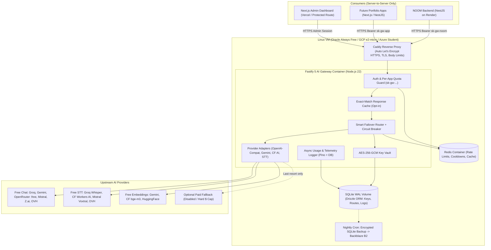

# AI Gateway — Master Context, Architecture & Implementation Plan

> **Status:** Planning / Pre-Implementation  
> **Workspace:** `ai-gateway`  
> **Primary Stack:** Node.js 22 LTS · TypeScript · **Fastify 5** · Drizzle ORM (SQLite WAL) · Redis · Next.js 16 Dashboard · Docker + Caddy on Linux VM  
> **Related Research Docs:**
> - [AI_GATEWAY_RESEARCH_REPORT.md](AI_GATEWAY_RESEARCH_REPORT.md)
> - [ARCHITECTURE_AND_PROVIDERS_DEEP_DIVE.md](ARCHITECTURE_AND_PROVIDERS_DEEP_DIVE.md)

---

## 1. Project Context, Motivation & Goals (Agent Handoff Summary)

*This section preserves the full background and design decisions from initial research so any developer or AI agent picking up this repo understands **why** every choice was made.*

### 1.1 Who This Is Built For & Why
- **Developer Profile:** JavaScript / TypeScript full-stack engineer (Next.js frontend, Node.js / NestJS / Express backends). Builds portfolio and personal web applications rather than paid production SaaS.
- **The Pain Point:** Existing portfolio apps (starting with **NOOM**, a Loom-style async video recorder in `noom`) rely on a single free Google Gemini API key, which frequently hits free-tier rate limits (`429`), experiences transient overloads (`503`), and has zero automatic failover.
- **Dual Project Goals:**
  1. **Practical Utility:** Run one personal, self-hosted **Universal AI Gateway** deployed in the cloud with per-app API keys (`sk-gw-...`) so every current and future portfolio app (`NOOM`, future AI-heavy Next.js/NestJS apps) can call one reliable OpenAI-compatible `/v1` endpoint backed by stacked **free-tier AI providers** (with optional paid-tier fallback + hard `$` caps later).
  2. **Personal Learning & Portfolio Showcase:** Build a clean, traditional server-side **Node.js (Fastify)** backend and deploy it on a real **Linux VM** using **Docker, Docker Compose, Caddy (HTTPS), GitHub Actions CI/CD, and automated encrypted backups**—serving as both a real DevOps learning exercise and a standout engineering portfolio project.

### 1.2 Strategy Adopted: "Option D" (Hybrid Split)
During research we deeply analyzed [`tashfeenahmed/freellmapi`](https://github.com/tashfeenahmed/freellmapi) (55.6k+ stars, MIT, TypeScript/Express/React/SQLite, 87 free providers). We decided on a **Hybrid Split (Option D)**:
- **Local Coding Usage (`freellmapi` as-is):** Run `tashfeenahmed/freellmapi` locally on Windows (tray app / Docker) wired to a separate `claude-free` PowerShell command and other local coding CLIs (Codex, Cline, Continue, etc.), leaving default `claude` untouched. *We do NOT need to re-implement 87 obscure providers or coding CLI installers in our custom gateway.*
- **Cloud Portfolio Apps (`ai-gateway` — THIS REPO):** Build our own lean, rock-solid **Fastify** AI Gateway focused on the **top 6–7 high-quality, zero-card free providers** plus **strict multi-app governance** that `freellmapi` lacks out-of-the-box.

### 1.3 Key Architectural Decisions & Why We Rejected Alternatives

| Decision | Chosen Option | Rejected Alternative(s) & Exact Reason |
| :--- | :--- | :--- |
| **Build vs. Fork `freellmapi`** | **Build from scratch** | `freellmapi` has 1,441 files (Electron desktop app, 60 languages, 64 obscure providers), is single-user/local-first by design, lacks **per-app RPM/RPD quotas**, lacks **per-app analytics**, lacks **paid `$` spend caps**, and has a bug in `/v1beta` (`gemini-wire.ts`) that converts Gemini audio `inlineData` into `image_url`. Building our own yields a cleaner, purpose-built system + far higher portfolio & learning value. |
| **Runtime & Framework** | **Node.js 22 + Fastify 5** | Rejected **Cloudflare Workers + Hono** because the developer specifically wants traditional Node.js server-side development + hands-on Linux/Docker DevOps practice (and wanted no 10ms CPU limits or serverless runtime constraints). Rejected **NestJS** because an AI Gateway is a lightweight HTTP proxy rather than a domain monolith (and `NOOM` already showcases NestJS). Chose **Fastify 5** over Express for superior TypeScript/Zod integration, native `pino` structured logging, built-in OpenAPI/Swagger, and high-throughput streaming ergonomics. |
| **Hosting Target** | **Always-Free Linux VM** *(Primary: Oracle Cloud Always Free; Fallbacks: Azure for Students or GCP `e2-micro`)* | Rejected **Render Free** because Render pools **750 free hours/month across the entire workspace**, and `NOOM`'s NestJS backend is already hosted on Render—pinging a second Render service 24/7 (~744h) would exhaust the shared pool and suspend `NOOM`. Rejected **Cloudflare R2** style card-attached overage risks: on **Oracle Always Free** (staying strictly off PAYG), overage billing is hard-blocked (`$0` guaranteed). |
| **Database** | **SQLite (WAL mode) + Drizzle ORM** *(PostgreSQL optional if landing a 12+ GB Oracle ARM VM)* | On a **1 GB RAM** free micro VM (`E2.1.Micro` or `e2-micro`), running Postgres eats ~150–250 MB RAM; SQLite in WAL mode via `better-sqlite3` uses ~0 extra container RAM, pairs natively with Drizzle ORM, and backs up cleanly as a single encrypted file to Backblaze B2. |
| **Rate Limiting & Cooldowns** | **Local Redis Container** (`ioredis`) | Runs inside the same `docker-compose.yml` (~25–35 MB RAM), zero external free-tier API limits, atomic sliding/fixed-window rate limits, circuit-breaker cooldowns, and opt-in exact-match response caching. Includes an in-memory adapter fallback for zero-dependency unit tests. |

### 1.4 First Real Consumer: `NOOM` (`noom`)
Auditing `noom-backend/src/ai/` revealed:
- `NOOM` already isolates AI behind a clean `TranscriptionProvider` port (`noom/noom-backend/src/ai/ai.port.ts` & `noom/noom-backend/src/ai/ai.module.ts`).
- Currently, `noom/noom-backend/src/ai/gemini-transcription.provider.ts` sends ~1.2 MB mono Opus audio (`audio/ogg`, max 5 mins) inline to Gemini `/v1beta:generateContent` to get `language`, timestamped `segments`, `chapters`, `summary`, and `title`.
- **Gateway Requirement Driven by NOOM:** Our gateway MUST provide:
  1. `POST /v1/audio/transcriptions` (multipart audio upload returning OpenAI `verbose_json` with timestamped `segments`, routed across **Groq Whisper Large v3 → Cloudflare Workers AI Whisper → Mistral Voxtral → OVH**).
  2. `POST /v1/chat/completions` with `response_format: { type: "json_schema" | "json_object" }` so NOOM's second step generates validated `chapters`, `summary`, and `title` with automatic multi-provider failover.

---

## 2. Proposed System Architecture

### 2.1 High-Level Runtime Architecture (Linux VM)



### 2.2 Monorepo Directory Structure

Use **pnpm workspaces** (fast, strict, low disk usage) with clean separation between shared contracts, the Fastify server, and the Next.js admin UI:

```text
ai-gateway/
├── .github/
│   └── workflows/
│       ├── ci.yml                 # Lint, typecheck, Vitest suite on PR/push
│       └── deploy.yml             # Build multi-stage Docker image -> GHCR -> SSH VM deploy
├── apps/
│   ├── gateway/                   # Fastify 5 AI Gateway (Node.js 22 + TypeScript)
│   │   ├── Dockerfile             # Multi-stage alpine/slim production build
│   │   ├── drizzle.config.ts
│   │   ├── src/
│   │   │   ├── server.ts          # Fastify bootstrap & graceful shutdown (SIGTERM)
│   │   │   ├── app.ts             # buildApp() factory (enables fastify.inject() testing)
│   │   │   ├── config/
│   │   │   │   └── env.ts         # Zod-validated env schema (fail-fast on boot)
│   │   │   ├── db/
│   │   │   │   ├── index.ts       # better-sqlite3 (WAL, busy_timeout, foreign_keys) + Drizzle
│   │   │   │   ├── schema.ts      # All Drizzle tables & relations
│   │   │   │   └── migrations/    # SQL migrations generated by drizzle-kit
│   │   │   ├── lib/
│   │   │   │   ├── crypto.ts      # AES-256-GCM encrypt/decrypt, SHA-256, timingSafeEqual
│   │   │   │   ├── redis.ts       # ioredis client + in-memory fallback for unit tests
│   │   │   │   ├── errors.ts      # OpenAI-shaped error responses & upstream error classifier
│   │   │   │   └── sse.ts         # SSE stream proxy, first-byte buffering & token extraction
│   │   │   ├── plugins/
│   │   │   │   ├── auth.ts        # sk-gw-... app key auth + Admin session auth hooks
│   │   │   │   ├── rate-limit.ts  # Inbound per-app RPM/RPD guard (Redis)
│   │   │   │   └── swagger.ts     # @fastify/swagger + /docs OpenAPI UI
│   │   │   ├── providers/
│   │   │   │   ├── types.ts       # ChatAdapter, SttAdapter, EmbeddingsAdapter interfaces
│   │   │   │   ├── registry.ts    # Built-in provider definitions & URL/header presets
│   │   │   │   ├── openai-compat.ts # Handles Groq, OpenRouter, Mistral, Z.ai, OVH, NVIDIA, Paid
│   │   │   │   ├── gemini.ts      # OpenAI Chat/JSON-Schema <-> Gemini REST translator
│   │   │   │   ├── cloudflare.ts  # Cloudflare Workers AI REST (Chat, Whisper STT, bge-m3)
│   │   │   │   └── stt.ts         # Multipart STT adapters (Groq Whisper, CF, Mistral, OVH)
│   │   │   ├── services/
│   │   │   │   ├── router.service.ts       # Route resolution, failover loop, paid fallback gate
│   │   │   │   ├── circuit-breaker.service.ts # Cooldowns & Retry-After tracking in Redis
│   │   │   │   ├── quota.service.ts        # Outbound upstream RPM/RPD/TPM/TPD & $ spend ledger
│   │   │   │   ├── cache.service.ts        # Opt-in SHA-256 exact-match Redis response cache
│   │   │   │   ├── analytics.service.ts    # Async request_logs writer & dashboard aggregations
│   │   │   │   ├── vault.service.ts        # CRUD + live health-test for upstream provider keys
│   │   │   │   └── app-keys.service.ts     # Mint, rotate, revoke, scope per-app sk-gw-... keys
│   │   │   └── routes/
│   │   │       ├── health.routes.ts        # GET /health (liveness), GET /ready (DB+Redis check)
│   │   │       ├── v1/
│   │   │       │   ├── chat.routes.ts      # POST /v1/chat/completions
│   │   │       │   ├── audio.routes.ts     # POST /v1/audio/transcriptions
│   │   │       │   ├── embeddings.routes.ts # POST /v1/embeddings (Phase 2)
│   │   │       │   └── models.routes.ts    # GET /v1/models
│   │   │       └── admin/
│   │   │           ├── auth.routes.ts      # Admin login/logout/session
│   │   │           ├── providers.routes.ts # Provider keys CRUD + test button
│   │   │           ├── routes.routes.ts    # Routing profiles & fallback chain ordering
│   │   │           ├── apps.routes.ts      # Per-app keys, quotas & allowed routes
│   │   │           └── analytics.routes.ts # Usage breakdowns, latency, quota status
│   │   └── test/                  # Vitest unit + Fastify inject() integration tests
│   └── dashboard/                 # Next.js 16 Admin UI (Tailwind + shadcn/ui) — Phase 2
├── packages/
│   └── shared/                    # Shared Zod schemas, API DTOs, error codes
├── deploy/
│   ├── docker-compose.yml         # gateway + redis + caddy
│   ├── Caddyfile                  # Auto HTTPS reverse proxy + security headers
│   ├── backup.sh                  # Encrypted SQLite backup -> Backblaze B2
│   └── .env.example
├── pnpm-workspace.yaml
├── package.json
├── AI_GATEWAY_RESEARCH_REPORT.md
├── ARCHITECTURE_AND_PROVIDERS_DEEP_DIVE.md
└── IMPLEMENTATION_PLAN.md
```

---

## 3. Database Schema Design (Drizzle ORM + SQLite WAL)

*All secrets are encrypted with AES-256-GCM (`encrypted_secret`, `iv`, `auth_tag`). All client API keys are stored as SHA-256 hashes for lookup (`key_hash`) plus a short visible prefix (`key_prefix`, e.g., `sk-gw-noom...`) for dashboard identification.*

### Core Tables

1. **`provider_keys`** — Your upstream free/paid AI provider credentials
   - `id` (TEXT UUID PK)
   - `provider` (TEXT: `groq` | `google` | `openrouter` | `mistral` | `cloudflare` | `zhipu` | `ovh` | `huggingface` | `nvidia` | `custom`)
   - `label` (TEXT, e.g., `"Groq Primary"`)
   - `base_url` (TEXT nullable — required for `custom`, optional override for others)
   - `encrypted_secret` (TEXT nullable — null for keyless providers like `ovh`)
   - `iv` (TEXT nullable), `auth_tag` (TEXT nullable)
   - `extra_config_json` (TEXT nullable — e.g., `{ "accountId": "..." }` for Cloudflare)
   - `tier` (TEXT: `'free'` | `'paid'`, default `'free'`)
   - `enabled` (INTEGER boolean, default `1`)
   - `health_status` (TEXT: `'unknown'` | `'healthy'` | `'degraded'` | `'invalid'`)
   - `last_checked_at` (INTEGER epoch ms nullable)
   - `rpm_limit`, `rpd_limit`, `tpm_limit`, `tpd_limit` (INTEGER nullable — provider-level safety caps)
   - `monthly_usd_cap` (REAL nullable — hard dollar ceiling for `tier = 'paid'`, default `0`)
   - `created_at`, `updated_at` (INTEGER epoch ms)

2. **`provider_models`** — Specific models configured under each provider
   - `id` (TEXT UUID PK)
   - `provider_key_id` (TEXT FK → `provider_keys.id` ON DELETE CASCADE)
   - `upstream_model_id` (TEXT, e.g., `llama-3.3-70b-versatile`, `whisper-large-v3-turbo`, `gemini-2.5-flash`)
   - `modality` (TEXT: `'chat'` | `'stt'` | `'embeddings'`)
   - `embedding_family` (TEXT nullable — enforces strict same-dimension failover for embeddings, e.g., `bge-m3-1024`)
   - `supports_tools` (INTEGER boolean), `supports_json_schema` (INTEGER boolean), `supports_vision` (INTEGER boolean)
   - `context_window` (INTEGER nullable)
   - `rpm_limit`, `rpd_limit`, `tpm_limit`, `tpd_limit` (INTEGER nullable — per-model free-tier caps)
   - `input_cost_per_1m`, `output_cost_per_1m` (REAL default `0`)
   - `enabled` (INTEGER boolean, default `1`)

3. **`routing_profiles`** — Logical routes that client apps request (e.g., `auto`, `auto:fast`, `auto:noom`, `auto:stt`)
   - `id` (TEXT UUID PK)
   - `slug` (TEXT UNIQUE — e.g., `auto`, `auto:fast`, `auto:smart`, `auto:noom`, `auto:stt`, `auto:embed`)
   - `modality` (TEXT: `'chat'` | `'stt'` | `'embeddings'`)
   - `strategy` (TEXT: `'priority'` | `'lowest_latency'` | `'round_robin'`, default `'priority'`)
   - `description` (TEXT nullable)

4. **`routing_profile_entries`** — Ordered fallback chain per routing profile
   - `id` (TEXT UUID PK)
   - `profile_id` (TEXT FK → `routing_profiles.id` ON DELETE CASCADE)
   - `provider_model_id` (TEXT FK → `provider_models.id` ON DELETE CASCADE)
   - `priority` (INTEGER — lower runs first; free models `1..99`, paid last-resort `100+`)
   - `timeout_ms` (INTEGER default `30000`)
   - `enabled` (INTEGER boolean, default `1`)

5. **`app_keys`** — Per-application virtual API keys (`sk-gw-...`)
   - `id` (TEXT UUID PK)
   - `name` (TEXT UNIQUE, e.g., `"noom-prod"`, `"resume-analyzer"`, `"local-dev"`)
   - `key_hash` (TEXT UNIQUE — SHA-256 hex digest)
   - `key_prefix` (TEXT — first 12 chars for masked display)
   - `allowed_profiles_json` (TEXT — JSON array of permitted profile slugs, e.g., `["auto:noom","auto:stt"]`, or `["*"]`)
   - `allow_paid_fallback` (INTEGER boolean, default `0` — fail-closed!)
   - `max_rpm` (INTEGER default `20`), `max_rpd` (INTEGER default `500`), `max_tpd` (INTEGER nullable)
   - `enabled` (INTEGER boolean, default `1`)
   - `last_used_at` (INTEGER nullable)
   - `created_at`, `updated_at` (INTEGER epoch ms)

6. **`request_logs`** — Telemetry & analytics ledger (pruned automatically after 90 days)
   - `id` (TEXT UUID PK)
   - `request_id` (TEXT)
   - `app_key_id` (TEXT FK → `app_keys.id` ON DELETE SET NULL)
   - `endpoint` (TEXT: `chat` | `stt` | `embeddings`)
   - `requested_model` (TEXT)
   - `served_provider` (TEXT nullable)
   - `served_model` (TEXT nullable)
   - `status_code` (INTEGER)
   - `latency_ms` (INTEGER)
   - `ttfb_ms` (INTEGER nullable)
   - `prompt_tokens` (INTEGER default `0`)
   - `completion_tokens` (INTEGER default `0`)
   - `estimated_cost_usd` (REAL default `0`)
   - `fallback_attempts` (INTEGER default `0`)
   - `cache_hit` (INTEGER boolean default `0`)
   - `error_code` (TEXT nullable)
   - `created_at` (INTEGER epoch ms, indexed)

7. **`admin_users` & `admin_sessions`** — Admin dashboard auth (single owner account seeded via CLI/env on first boot, Argon2id password hash, HTTP-only signed session cookie).

---

## 4. Core Engine Design & Request Lifecycle

### 4.1 End-to-End Request Flow (`POST /v1/chat/completions`)

1. **Authenticate (`plugins/auth.ts`):**
   - Extract `Authorization: Bearer sk-gw-...` → SHA-256 hash → lookup in `app_keys` (cached in Redis for 60s) → verify `enabled === 1`.
   - Reject missing/invalid/disabled keys immediately with OpenAI-shaped `401 authentication_error`.
2. **Enforce Per-App Policy & Rate Limits (`plugins/rate-limit.ts`):**
   - Verify requested `model` (e.g., `auto:noom`) is inside `app.allowed_profiles_json` → else `403 permission_error`.
   - Check Redis counters for `rl:app:{appId}:min:{minute}` (`max_rpm`) and `rl:app:{appId}:day:{yyyy-mm-dd}` (`max_rpd`) → if exceeded, return `429 rate_limit_exceeded` with `Retry-After` header.
3. **Opt-In Cache Lookup (`services/cache.service.ts` — Phase 2):**
   - If `X-Gateway-Cache: on` (and `temperature <= 0.2`, non-tool request), hash canonical `(requestedModel, messages, response_format)` → check Redis. On hit, return immediately with `X-Gateway-Cache: HIT` and `0` upstream quota used.
4. **Build Ordered Candidate List (`services/router.service.ts`):**
   - Resolve `model` slug → ordered `routing_profile_entries`.
   - Filter out candidates that:
     - lack required capability (`tools` requested → skip models with `supports_tools = 0`; `json_schema` requested → skip unsupported; `image_url` present → skip non-vision);
     - are currently on **circuit-breaker cooldown** in Redis (`cb:{providerModelId}`);
     - have hit their tracked upstream `rpm`/`rpd`/`tpd` cap in Redis;
     - are `tier = 'paid'` unless `app.allow_paid_fallback === 1` **and** current month's paid spend `< monthly_usd_cap`.
   - Always sort `tier = 'free'` candidates strictly ahead of `tier = 'paid'`.
5. **Failover Execution Loop (Non-Streaming & Streaming SSE):**
   - Maintain a total wall-clock budget (e.g., `45s` for chat, `90s` for STT) and `AbortController` wired to client socket close (`req.raw.on('close', ...)`).
   - For each candidate:
     - Decrypt upstream key in-memory (`vault.decrypt`).
     - Call adapter (`openai-compat`, `gemini`, or `cloudflare`).
     - **Critical Streaming Rule:** Do **NOT** flush HTTP `200` headers to the client until the upstream returns `2xx` **and** yields the first valid stream chunk (or complete JSON for non-stream).
       - If upstream fails **before** headers commit (`429`, `500–504`, network error, timeout) → classify error, trip circuit breaker cooldown in Redis, increment `fallback_attempts`, and seamlessly try the next candidate!
       - Once headers + first chunk commit → pipe SSE chunks directly to client; if upstream drops mid-stream, emit a clean SSE error frame and close.
     - If all candidates fail → return `503 service_unavailable` (or `429` if all were rate-limited) with a concise, client-safe diagnostic summary (never leaking upstream keys or raw stack traces).
6. **Record Telemetry & Quota (`services/analytics.service.ts` + `services/quota.service.ts`):**
   - Set response headers: `X-Gateway-Provider`, `X-Gateway-Model`, `X-Gateway-Attempts`, `X-Gateway-Cache`.
   - Increment upstream RPM/RPD/TPD counters (and estimated `$` spend if paid) in Redis.
   - Write row to `request_logs` asynchronously (never blocking response completion).

### 4.2 Error Classification & Circuit Breaker Policy

| Upstream Signal | Classification | Action | Cooldown Duration |
| :--- | :--- | :--- | :--- |
| `429 Too Many Requests` | Rate Limited | Fail over to next candidate | Honor `Retry-After` header if present, else `60s` (escalating to `5m` on consecutive 429s) |
| `500`, `502`, `503`, `504`, Timeout | Transient Outage | Fail over to next candidate | `30s` → `2m` exponential backoff |
| `401`, `403` (Auth / Quota Dead) | Credential Failure | Mark `provider_key` degraded/invalid, fail over | `15m` cooldown (+ optional webhook alert) |
| `400`, `413`, `422` | Client / Payload Error | Do **NOT** blindly retry 10 providers if payload itself is invalid (except model-specific unsupported param quirks) | `0s` — return `400`/`413` to caller |

---

## 5. Complete API Contract

### 5.1 Data Plane (Used by Your Portfolio Apps — Auth: `Bearer sk-gw-...`)
- `POST /v1/chat/completions` — OpenAI Chat Completions (streaming SSE, non-streaming, `response_format`, `tools`, `temperature`, `max_tokens`, `X-Gateway-Cache`)
- `POST /v1/audio/transcriptions` — OpenAI Whisper Multipart STT (`file`, `model: "auto:stt"`, `response_format: "verbose_json" | "json" | "text"`, `language`, `prompt`)
- `POST /v1/embeddings` *(Phase 2)* — OpenAI Embeddings (family-locked failover)
- `GET /v1/models` — Lists logical routing profiles allowed for the caller's `sk-gw-...` key

### 5.2 Admin Plane (Used by Next.js Dashboard — Auth: Admin Session Cookie / Bearer)
- `POST /admin/api/auth/login`, `POST /admin/api/auth/logout`, `GET /admin/api/auth/me`
- `GET/POST/PATCH/DELETE /admin/api/providers` + `POST /admin/api/providers/:id/test`
- `GET/POST/PATCH/DELETE /admin/api/models`
- `GET/POST/PATCH/DELETE /admin/api/profiles` + `PUT /admin/api/profiles/:id/entries` (reorder fallback chain)
- `GET/POST/PATCH/DELETE /admin/api/apps` + `POST /admin/api/apps/:id/rotate`
- `GET /admin/api/analytics/overview` (24h / 7d / 30d totals, by-app breakdown, by-provider success rate, p50/p95 latency, remaining free quotas)
- `GET /admin/api/logs` (paginated, filterable request logs)

### 5.3 Operations Plane
- `GET /health` — Fast liveness probe (`200 { status: "ok" }`, no DB hit)
- `GET /ready` — Readiness probe (verifies SQLite + Redis connectivity)
- `GET /docs` — Swagger / OpenAPI UI (disabled or admin-gated in production)

---

## 6. Curated Free-Tier Provider Roster (Cloud Gateway Starter Set)

*Detailed limits and 2026 verification notes live in [ARCHITECTURE_AND_PROVIDERS_DEEP_DIVE.md](ARCHITECTURE_AND_PROVIDERS_DEEP_DIVE.md). Start with these **6–7 zero-card providers** (do NOT waste time on retired 2026 providers like GitHub Models, SambaNova, Cerebras, OpenCode Zen, or personal-banned Cohere):*

1. **Groq** (`OpenAICompatAdapter` + `SttAdapter`) — Primary fast chat (`llama-3.3-70b-versatile`, `qwen`, `gpt-oss-120b`) + **Primary STT for NOOM** (`whisper-large-v3-turbo` / `whisper-large-v3`: 20 RPM, 2,000 RPD, 8 hrs audio/day free).
2. **Google AI Studio / Gemini** (`GeminiAdapter`) — Primary smart/long-context chat (`gemini-2.5-flash` / Flash-Lite) + `gemini-embedding-001`.
3. **OpenRouter (`:free`)** (`OpenAICompatAdapter`) — Broad rotating open-model fallback pool (`20 RPM / 50 RPD`, or `1,000 RPD` forever if a one-time `$10` credit is ever deposited).
4. **Cloudflare Workers AI** (`CloudflareAiAdapter`, REST) — **Secondary STT for NOOM** (`@cf/openai/whisper-large-v3-turbo`) + **Primary `bge-m3` embeddings** + text fallback (hard-cap at `9,000` of `10,000` daily free neurons).
5. **Mistral AI** (`OpenAICompatAdapter` + `SttAdapter`) — Secondary chat/coding + Voxtral STT fallback (respect `1 RPS` cap).
6. **Zhipu / Z.ai** (`OpenAICompatAdapter`) — Strong 128k-context free Flash fallback (`glm-4.7-flash` / `glm-4.5-air`, use `60s` timeout).
7. **OVHcloud AI Endpoints** (`OpenAICompatAdapter`, **keyless!**) — Zero-signup bottom-of-chain safety net (`2 RPM/IP`, Llama 3.3 70B + Whisper).

---

## 7. Linux VM & DevOps Deployment Blueprint

### 7.1 Target VM Provisioning & Hardening
- **Primary Target:** **Oracle Cloud Always Free** (Ubuntu 24.04 LTS — either `VM.Standard.A1.Flex` ARM if available, or `VM.Standard.E2.1.Micro` 1 GB RAM x86, **strictly without upgrading to PAYG**).
- **Fallbacks:** **Azure for Students** (`B1s` Ubuntu VM, `$100` hard-capped student credit, no card) OR **GCP Always Free `e2-micro`** (`us-central1`/`us-west1`, `pd-standard` 30 GB disk, `$1` billing alert).
- **Server Baseline Setup Checklist:**
  1. Create non-root `deploy` user, disable SSH password auth & root login (`PermitRootLogin no`, `PasswordAuthentication no`).
  2. Enable `ufw` firewall allowing **only** `22/tcp` (SSH), `80/tcp` (HTTP→HTTPS redirect), and `443/tcp` (HTTPS).
  3. Add a **2 GB swap file** (essential safety cushion on 1 GB RAM micro VMs during Docker image pulls/restarts).
  4. Install Docker Engine + Docker Compose plugin + `unattended-upgrades`.

### 7.2 Production Containers (`deploy/docker-compose.yml`)
- **`caddy`** (`caddy:2-alpine`, ~25 MB RAM): Automatic Let's Encrypt HTTPS for `gw.yourdomain.com`, reverse-proxies `/v1/*` and `/health` to `gateway:3000`, restricts `/docs` and `/admin/*` (optional IP/BasicAuth/CORS rules), enforces `25MB` max upload body for audio.
- **`gateway`** (custom multi-stage Node 22 slim image, ~80–120 MB RAM): Non-root `USER node`, mounts persistent volume `/app/data` for SQLite WAL database, runs Drizzle migrations on boot, exposes `/health` Docker `HEALTHCHECK`.
- **`redis`** (`redis:7-alpine`, ~25–35 MB RAM): Configured with `--maxmemory 64mb --maxmemory-policy allkeys-lru` so it can never OOM a 1 GB VM.

### 7.3 CI/CD & Backups
- **CI (`.github/workflows/ci.yml`):** On every push/PR → `pnpm install --frozen-lockfile` → `pnpm lint` → `pnpm typecheck` → `pnpm test` (Vitest + Fastify `inject()` suite).
- **CD (`.github/workflows/deploy.yml`):** On push to `main` → build & push Docker image to `ghcr.io/<user>/ai-gateway` → SSH into VM → `docker compose pull && docker compose up -d` → verify `curl -f https://gw.yourdomain.com/ready`.
- **Encrypted Offsite Backups (`deploy/backup.sh`):** Nightly cron runs `sqlite3 /data/gateway.db ".backup '/tmp/gw.db'"` (safe online WAL snapshot), encrypts with `openssl enc -aes-256-cbc -pbkdf2`, and uploads to **Backblaze B2** (reusing the B2 bucket setup from `NOOM`, keeping last 14 daily backups).
- **External Monitoring:** Free **Better Stack** or **UptimeRobot** monitor hitting `GET https://gw.yourdomain.com/health` every 5 minutes + Discord/email alert on downtime.

---

## 8. Phased Implementation Roadmap (Agent Execution Milestones)

### Milestone 0 — Monorepo & Engineering Foundation (Day 1)
- Initialize pnpm workspace (`apps/gateway`, `packages/shared`), strict `tsconfig.base.json`, ESLint, Prettier, Vitest.
- Scaffold Fastify 5 `buildApp()` + Zod env validation (`ENCRYPTION_KEY`, `PORT`, `DB_PATH`, `REDIS_URL`) + `GET /health` & `GET /ready` + `pino` structured logging + `@fastify/swagger`.
- **Verification:** `pnpm test` passes with Fastify `app.inject()` health test; `pnpm dev` starts cleanly.

### Milestone 1 — Database, Crypto Vault & Per-App Auth (Days 2–3)
- Implement Drizzle SQLite schema (`WAL` mode + `busy_timeout = 5000`), migrations, and `lib/crypto.ts` (AES-256-GCM + SHA-256 + `timingSafeEqual`).
- Implement `vault.service.ts` (store/decrypt upstream keys), `app-keys.service.ts` (mint/hash/verify `sk-gw-...`), and `plugins/auth.ts` + `plugins/rate-limit.ts` (Redis RPM/RPD enforcement with in-memory test fallback).
- Add a CLI seed script (`pnpm seed`) to bootstrap an admin user, initial routing profiles (`auto`, `auto:fast`, `auto:noom`, `auto:stt`), and `.env`-imported provider keys.
- **Verification:** Unit tests for AES-GCM roundtrip, key masking, `401` invalid key, `403` disallowed profile, and `429` per-app rate limit enforcement.

### Milestone 2 — Chat Completions Engine, Adapters & Failover (Days 4–6)
- Build `OpenAICompatAdapter` (Groq, OpenRouter, Mistral, Z.ai, OVH, Custom) and `GeminiAdapter` (OpenAI chat + `response_format` JSON schema + `tools` ↔ Gemini REST).
- Build `router.service.ts`, `circuit-breaker.service.ts`, `quota.service.ts`, and `lib/sse.ts` (first-byte buffering before header commit + client abort propagation).
- Expose `POST /v1/chat/completions` (streaming SSE & non-streaming) and `GET /v1/models`.
- **Verification:** Integration tests using mocked upstream servers proving: (a) seamless failover on `429` and `503` before first byte, (b) circuit breaker skips cooled-down provider on next request, (c) SSE streaming chunks pass through cleanly with `X-Gateway-Provider` header, (d) structured JSON schema works across Groq + Gemini.

### Milestone 3 — Audio Transcription (`/v1/audio/transcriptions`) & `NOOM` Integration (Days 7–8)
- Add `@fastify/multipart` (in-memory buffer capped at `25 MB`, auth checked before buffering).
- Build `SttAdapter` supporting **Groq Whisper** → **Cloudflare Workers AI Whisper** → **Mistral Voxtral** → **OVH** with normalized `verbose_json` (`{ task, language, duration, text, segments }`).
- Wire `POST /v1/audio/transcriptions` into the same circuit breaker, quota tracker, and async `request_logs` logger.
- Implement `GatewayTranscriptionProvider` in `noom-backend/src/ai/` behind existing `TranscriptionProvider` port (2-step: `/v1/audio/transcriptions` → `/v1/chat/completions` structured chapters/summary/title).
- **Verification:** End-to-end test uploading a real `.ogg` clip from `NOOM`, triggering primary STT failover, and validating output against NOOM's `transcript.schema.ts`.

### Milestone 4 — Production DevOps Deployment on Linux VM (Days 9–10)
- Write multi-stage `apps/gateway/Dockerfile`, `deploy/docker-compose.yml` (`gateway` + `redis` + `caddy`), `deploy/Caddyfile`, and `deploy/backup.sh`.
- Provision Linux VM (Oracle Always Free / fallback), harden SSH + `ufw` + 2 GB swap, point custom domain DNS (`gw.yourdomain.com`), and deploy via GitHub Actions CI/CD.
- Verify live HTTPS TLS cert, `/ready` health check, encrypted Backblaze B2 backup run, and live `NOOM` backend calling `https://gw.yourdomain.com/v1`.

### Milestone 5 — Admin API, Next.js Dashboard & Phase 2 Polish (Week 3)
- Build `/admin/api/*` routes (protected by Argon2id login + HTTP-only session cookie) for managing provider keys (with "Test Key" button), app keys/quotas, fallback chain ordering, and analytics queries.
- Build `apps/dashboard` (**Next.js 16 + Tailwind + shadcn/ui**): Keys Vault, Routing Chains, App Keys & Quotas, Analytics Charts (by app & by provider), and Live Playground.
- Add Phase 2 enhancements: opt-in Redis exact-match response cache (`X-Gateway-Cache: on`), `POST /v1/embeddings` (family-locked failover), and `tier = 'paid'` last-resort fallback with hard `monthly_usd_cap` circuit breaker.

---

## 9. Integration Examples (For Consuming Apps)

### 9.1 `NOOM` Backend Adapter (`noom-backend/src/ai/gateway-transcription.provider.ts`)
Implements NOOM's existing `TranscriptionProvider` port with zero changes to `TranscriptsService`:
1. `POST ${AI_GATEWAY_URL}/v1/audio/transcriptions` (`multipart/form-data`, `model=auto:stt`, `response_format=verbose_json`) → receives timestamped `segments` + `language` + `text`.
2. `POST ${AI_GATEWAY_URL}/v1/chat/completions` (`model=auto:noom`, `response_format={ type: "json_schema", ... }`) → passes timestamped transcript text, receives `chapters`, `summary`, and `title`.
3. Validates with existing `transcriptionResponseSchema` + `normalize()` in `transcript.schema.ts`.

### 9.2 Future Next.js Apps (Server-Side Route Handler / Server Action)
```ts
import { createOpenAICompatible } from '@ai-sdk/openai-compatible';
import { streamText } from 'ai';

const gateway = createOpenAICompatible({
  name: 'personal-ai-gateway',
  baseURL: process.env.AI_GATEWAY_URL!,      // https://gw.yourdomain.com/v1
  apiKey: process.env.AI_GATEWAY_API_KEY!,   // sk-gw-myapp-... (NEVER NEXT_PUBLIC_)
});

export async function POST(req: Request) {
  const { messages } = await req.json();
  const result = streamText({ model: gateway('auto:fast'), messages });
  return result.toUIMessageStreamResponse();
}
```

---

## 10. Non-Negotiable Security & Engineering Guardrails (For All Agents)

1. **Never log secrets or raw media:** Upstream API keys, `sk-gw-...` bearer tokens, and raw audio buffers must NEVER appear in Pino logs, `request_logs`, error responses, or stack traces.
2. **Server-to-server only for app keys:** App keys (`sk-gw-...`) are server-side secrets; never instruct or wire browser/client components to call the gateway directly.
3. **Fail-closed paid billing:** `allow_paid_fallback` defaults to `false` on every app key, and `monthly_usd_cap` defaults to `0.00` on every provider key. Paid routes must NEVER execute unless explicitly opted in AND strictly under cap.
4. **Streaming safety:** Always propagate client disconnects via `AbortController` to upstream `fetch()` calls so aborted requests never waste free-tier provider tokens or continue retrying fallbacks.
5. **Single-user ToS compliance:** This gateway is strictly for the owner's personal projects and portfolio demos—no reselling, no multi-tenant public signups, and one account per upstream free provider.
6. **Testability first:** Keep `app.ts` (`buildApp()`) separate from `server.ts` (`listen()`) so every route, auth guard, rate limiter, and failover chain is testable deterministically via `fastify.inject()` without real network calls.
